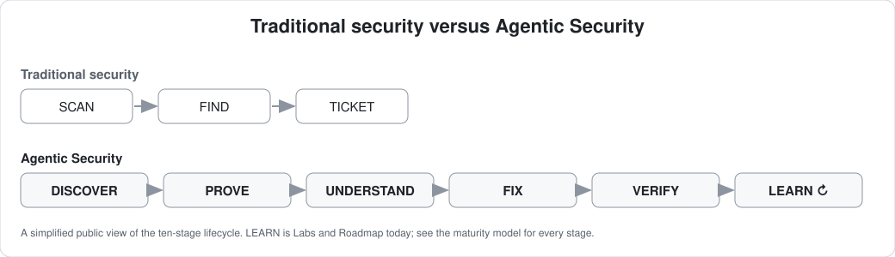
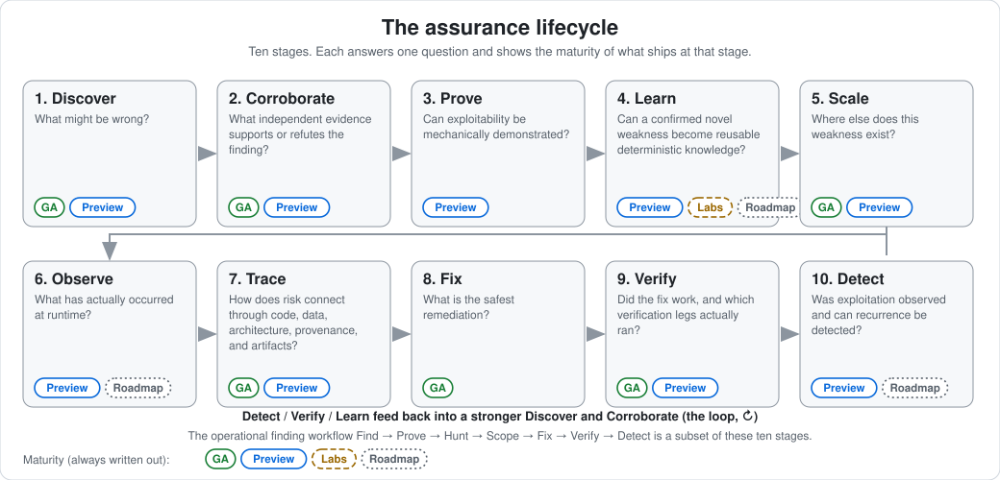
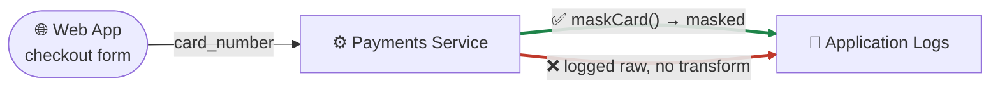

# Agentic Security

## Autonomous Security Assurance for the AI Software Era

**Discover vulnerabilities. Prove what's exploitable. Understand what's exposed. Fix it safely. Learn from every finding.**


Agentic Security is an autonomous security assurance platform. It pairs **deterministic analysis** with **security agents**: agents discover, challenge, fix and learn, and mechanical evidence decides what is claimed. It looks for weaknesses, tries to disprove its own findings, proves exploitability where it can, shows what a flaw can reach, fixes it through a verification gate, and turns confirmed discoveries into reusable knowledge.

**[Try the 5-Minute Demo](docs/quickstart/5-minute-demo.md)** · **[See How It Works](docs/how-it-works/assurance-lifecycle.md)** · **[Read the Evidence Model](docs/how-it-works/evidence-model.md)**

[](https://github.com/Clear-Capabilities/agentic-security/actions/workflows/ci.yml)
[](./LICENSE)
[]()
[]()

> Built by **[Clear Capabilities](https://www.clearcapabilities.com/)**. Also known as an *agentic security harness* for Claude Code, Codex, Cursor and Gemini CLI.

> **Evidence, not magic.** Agentic Security never treats an unavailable analyzer, skipped validation step, partial scan, or failed verification leg as proof that code is safe.
> Read the [Evidence Model](docs/how-it-works/evidence-model.md), [Scan Health](docs/trust/scan-health.md), [Verified Remediation](docs/trust/verified-remediation.md) and [Trust & Limitations](docs/trust/trust-and-limitations.md).

**Contents:** [Why it is different](#why-it-is-different) · [Why trust it](#why-trust-its-claims) · [Try it](#try-it-in-five-minutes) · [Lifecycle](#how-the-assurance-lifecycle-works) · [What exists today](#what-exists-today) · [Code Boundaries](#code-boundaries-the-security-graph-underneath) · [Roles](#where-do-i-go-for-my-role) · [Install](#install) · [Commands](#commands) · [Limitations](#what-agentic-security-is-not) · [Language coverage](#language-coverage) · [More](#detailed-limitations-and-reference)

---

## Why it is different

A scanner hands you a list. Agentic Security treats each finding as a claim to be tested.



```text
Traditional security
SCAN → FIND → TICKET

Agentic Security
DISCOVER → PROVE → UNDERSTAND → FIX → VERIFY → LEARN ↻
```

That is the simplified public view. The complete ten-stage lifecycle is [below](#how-the-assurance-lifecycle-works).

- **Evidence before severity.** A model opinion is not enough for a security claim. Severity, confidence, reachability, exploit evidence and fix verification are kept as separate facts.
- **Deterministic plus agentic.** Agents where reasoning adds value, mechanical evidence wherever possible. A model proposes; it never sets severity, never confirms an exploit and never marks a fix verified.
- **It challenges its own findings.** Discovery may be aggressive. Confirmation is skeptical: a falsification pass tries to disprove each finding, and execution-backed proof is available where a reproducer exists.
- **It never fakes green.** A scan that did not finish is never reported as clean. See [Scan Health](docs/trust/scan-health.md).
- **It learns once.** A novel confirmed weakness can become a reusable rule (Preview today), so it is not rediscovered by a model each time.
- **It fixes through a gate.** Every patch is rescanned, linted and tested before it is written, and the report names the checks that ran and the ones that did not.

## Why trust its claims

Six principles, each with a page: **evidence before severity**, **deterministic plus agentic**, **challenge your own findings**, **prove, don't presume**, **learn once**, **never fake green**. The [trust and limitations page](docs/trust/trust-and-limitations.md) says what a clean result does and does not mean.

The claims below are the kind this project checks mechanically:

- Every capability carries exactly one maturity (**GA**, **Preview**, **Labs** or **Roadmap**) from a single registry, [`docs/capabilities.yaml`](docs/capabilities.yaml). A check fails the build if a page contradicts it or presents a Roadmap item as shipped.
- Independent accuracy has been measured once, on code the engine was not built from, and it is low: localized precision 6/19, recall 6/278, F1 0.040. It is the headline of the evidence, not a footnote: [engineering excellence evidence](docs/engineering-excellence/README.md).
- Quality figures come with the command that produced them: [metrics](docs/METRICS.md), [scorecard](docs/SCORECARD.md), [benchmarking methodology](docs/trust/benchmarking-methodology.md).
- The tool treats the repository it scans as hostile: [agent threat model](docs/trust/agent-threat-model.md).

## Try it in five minutes

This repo ships a small, deliberately vulnerable [demo app](examples/demo-app/) so a first run always finds something. Clone this repo (or point the scanner at your own project once you have tried it) and run:

```bash
npx @clear-capabilities/agentic-security-scanner ci examples/demo-app --assurance strict
```

`ci` is the CI-shaped entry point, the same command your pipeline runs. `--assurance strict` makes it gate on whether the scan *itself* finished cleanly, not just on what it found. (`--assurance` exists only on `ci`; there is no `scan --assurance`.) Real captured output, from a machine with a stale EPSS cache (captured with `agentic-security` on `PATH` after a global install; the `npx` form produces the identical output):

```text
$ agentic-security ci examples/demo-app --assurance strict
[ci] full scan (no baseline ref detected)
[ci] 44 findings — 3 critical · 6 high · 7 medium · 16 low · 12 info
[ci] ⚠ scan-health=partial — EPSS exploit-probability data is stale (20745 day(s) old)
[ci] artifacts: .agentic-security/findings.{json,sarif,junit.xml}
[ci] fail-on=critical  scan-exit=3
[ci] assurance gate FAILED (mode=strict): strict mode requires a fully complete scan; scanHealth.status is 'partial'
```

One run shows two different failure classes:

- **`fail-on=critical  scan-exit=3`** is the severity gate: real vulnerabilities at or above your threshold. Triage and remediate; see [Fixing vulnerabilities](docs/guides/fixing-vulnerabilities.md).
- **`assurance gate FAILED (mode=strict)`** is the assurance gate: the analysis itself did not finish cleanly (here, a stale EPSS cache), whatever it found. Investigate the scan, not the findings; see [Scan health troubleshooting](docs/troubleshooting/scan-health.md).

`advisory` and `standard` (the default) are mechanically identical: neither fails the build over scan health. Only `strict` gates. A scan that finds nothing is only reported as safe to deploy if it also finished cleanly; otherwise the verdict is "scan incomplete, cannot confirm safe to deploy". More: [Assurance modes](docs/trust/assurance-modes.md), the [5-minute demo](docs/quickstart/5-minute-demo.md), and the [15-minute quickstart](docs/guides/quickstart.md).

## How the assurance lifecycle works

Ten stages, one canonical order:

`Discover → Corroborate → Prove → Learn → Scale → Observe → Trace → Fix → Verify → Detect ↻`



<!-- generated:lifecycle:start -->
| Stage | Question | Maturity at this stage | Read |
|---|---|---|---|
| 1. Discover | What might be wrong? | **GA**, **Preview** | [Discover](./docs/discover/README.md) |
| 2. Corroborate | What independent evidence supports or refutes the finding? | **GA**, **Preview** | [Corroborate](./docs/corroborate/README.md) |
| 3. Prove | Can exploitability be mechanically demonstrated? | **GA** | [Prove](./docs/prove/README.md) |
| 4. Learn | Can a confirmed novel weakness become reusable deterministic knowledge? | **Preview**, **Labs**, **Roadmap** | [Learn](./docs/learn/README.md) |
| 5. Scale | Where else does this weakness exist? | **GA**, **Preview** | [Scale](./docs/scale/README.md) |
| 6. Observe | What has actually occurred at runtime? | **GA**, **Roadmap** | [Observe](./docs/observe/README.md) |
| 7. Trace | How does risk connect through code, data, architecture, provenance, and artifacts? | **GA**, **Preview** | [Trace](./docs/trace/README.md) |
| 8. Fix | What is the safest remediation? | **GA** | [Fix](./docs/fix/README.md) |
| 9. Verify | Did the fix work, and which verification legs actually ran? | **GA**, **Preview** | [Verify](./docs/verify/README.md) |
| 10. Detect | Was exploitation observed and can recurrence be detected? | **Preview**, **Roadmap** | [Detect](./docs/detect/README.md) |
<!-- generated:lifecycle:end -->

The operational workflow for working one finding, `Find → Prove → Hunt → Scope → Fix → Verify → Detect`, is a **subset** of this lifecycle. See [the finding lifecycle](docs/how-it-works/finding-lifecycle.md) and a real finding walked through every stage: [One finding's journey](docs/workflows/one-findings-journey.md).

`Detect / Verify / Learn → stronger future Discover and Corroborate`

## What exists today

Generated from [`docs/capabilities.yaml`](docs/capabilities.yaml). **GA** is production-supported, **Preview** is implemented and still being hardened, **Labs** is experimental, and **Roadmap** is not shipped. See the [maturity model](docs/how-it-works/maturity-model.md).

<!-- generated:capabilities:start -->
| Capability | Lifecycle Stage | Maturity | What It Establishes |
|---|---|---|---|
| [Deterministic security analysis](./docs/guides/scanning.md) | Discover | **GA** | A candidate weakness at a file and line, found by mechanical rules (SAST, secrets, IaC, auth, prompt-injection, MCP audit), with no model in the loop. |
| [Dependency risk with function-level reachability](./docs/guides/scanning.md) | Discover, Corroborate | **GA** | Which vulnerable dependencies exist, which are actively exploited, and whether the vulnerable function is actually reachable. |
| [Agentic discovery (hunt)](./docs/discover/README.md) | Discover | **Preview** | Model-proposed candidate weaknesses that no rule encodes, each routed back through the deterministic engine before it is reported. Advisory; needs a configured model endpoint. |
| [Deterministic context intelligence](./docs/guides/context-intelligence.md) | Discover, Corroborate | **Preview** | Per-entry-point, hash-bound context bundles and citation-checked focused reviews. Opt-in. |
| [Haskell and Nix/NixOS analysis](./docs/language-support.md) | Discover, Corroborate | **Preview** | Static findings for Haskell and Nix/NixOS, with support measured per capability on a synthetic corpus and some legs honestly blocked. |
| [Taint flow and reachability corroboration](./docs/corroborate/README.md) | Corroborate | **GA** | A hop-by-hop path from where untrusted data entered to the sink, and whether the flow is reachable from an entry point. |
| [Falsification of findings](./docs/concepts.md) | Corroborate | **GA** | Whether a context-matched control on the path (a sanitizer or dominating guard) blocks the finding. Lowers confidence only; never removes a finding and never changes severity. |
| [Model-assisted validation](./docs/how-it-works/deterministic-and-agentic.md) | Corroborate | **Preview** | A second-opinion verdict on a finding, recorded separately from the deterministic evidence. A no-op unless a model endpoint is configured. |
| [Execution-backed exploit proof](./docs/guides/exploit-proof-fabric.md) | Prove | **GA** | Whether a bounded, serialized reproducer (supplied, or generated by `proof generate`), run in a confined sandbox and judged by a deterministic oracle, reproduces the effect. Hosted CI exercises it on Linux under local confinement and in a real container, and the measurements are committed. Haskell is a proof language too (GHC's interpreter, packages that ship with GHC only; command injection and path-traversal writes are proven, server-side request forgery is refused), but it has been exercised only under local confinement on macOS, not in the hosted container leg. |
| [Finding-to-rule compiler](./docs/guides/rule-compiler.md) | Learn | **Preview** | Whether one proven finding can be promoted to a reviewed, deterministic detection rule (regular expressions over text, with structure) that passes its own corpus, a mutation set and a shared false-positive corpus. `rules synthesize --auto` can propose the rule; promotion is still decided by evidence. |
| [Detector spec synthesis](./commands/labs.md) | Learn | **Labs** | A detector-spec proposal drafted from sample vulnerable files, written for a human to review and never incorporated automatically. |
| [Security learning rate metric](./docs/roadmap/README.md) | Learn | **Roadmap** | The long-term measure of how many novel confirmed weakness patterns became reusable rules, tests or controls. Not an existing KPI. |
| [Repository-wide sibling sweep](./docs/reference/root-cause-sweep.md) | Scale | **GA** | Other instances of the same weakness in the repository, with found, candidate and mitigated counts reported separately. |
| [Fleet scanning and dependency blast radius](./docs/guides/fleet.md) | Scale | **Preview** | Idempotent, leased scan jobs for a declared set of repositories in a local SQLite store, an honest per-repository rollup, and which repositories depend on, or reference in code, a given one. Dependency matching is by declared package name; no remote workers or distributed queue. |
| [Cross-repository graph federation](./docs/reference/federation.md) | Scale, Trace | **GA** | A declared link between a node in this repository's graph and a node in another repository's graph export. Each graph stays unmodified. |
| [Runtime corroboration of the scanned graph](./docs/reference/runtime-corroboration-contract.md) | Observe | **GA** | Whether imported runtime telemetry (OpenTelemetry, Envoy, Kubernetes audit, HTTP access logs) matches nodes in the scanned graph, edge states (observed, blocked, policy violation, not observed, static only), identity tokens stored only as keyed hashes, and a static page of the five Explorer views. A complete, partial or unavailable status; telemetry is imported, not collected live. |
| [Continuous production runtime observation](./docs/roadmap/README.md) | Observe | **Roadmap** | Live collection of production behavior and exercised vulnerable functions. Not shipped; today's runtime support is offline telemetry import. |
| [Code Boundaries security graph](./docs/security-graph/code-boundaries.md) | Trace | **Preview** | Field-level sources, sinks, protection state, sensitive-data classes and findings as one signed graph, browsable locally. Opt-in at scan time. |
| [Blast-radius assessment](./docs/security-graph/blast-radius.md) | Trace | **GA** | What a compromised graph node can reach, including affected data classes and recipients, read from the already-scanned graph. |
| [Finding provenance from Git history](./docs/guides/finding-provenance.md) | Trace | **Preview** | Which commit introduced a finding, resolved from Git history, with the resolution quality stated. |
| [Graph precision, completeness and scale](./docs/security-graph/graph-precision.md) | Trace | **Preview** | Whether a graph analysis finished, and how far its answer reaches. Adds completion status, recursion handling, call-site correlation, demand queries, path conditions, incremental invalidation, boundary contracts, control-placement planning and replayable witness bundles, each with its limits stated. The typed graph view, boundary contracts, demand sink queries, control-placement planning and witness bundles are reachable from the CLI (`dataflow view|contracts|sink-query|plan-cuts`, `witness build|verify`), each opt-in and each reporting a completion status. Targets not yet met: incremental analysis is 2.5x and 2.4x on the two synthetic projects against a 3x target, 75 of 982 sink sites still take the full path in demand queries, the multi-service fixture finds 3 of 8 labeled positives, the optional z3 backend is not used by a default scan, and the precision figures come from a development sample; on an independent sample of the whole default scan the measured precision was 11.7% for JavaScript and TypeScript and 6.8% for Nix (one LLM labeler, wide intervals; bench/dag/independent). |
| [Source-to-artifact provenance](./docs/guides/artifact-provenance.md) | Trace | **GA** | Whether a finding is present in a built container image and whether a fix in source reached it. Images come from OCI or Docker archives, a local Docker or Podman engine, or one named registry reference; the engine, registry and signing paths are exercised by a hosted job against a real container engine, a real registry and a real signing tool. |
| [Fix synthesis](./docs/guides/fixing-vulnerabilities.md) | Fix | **GA** | A candidate patch, deterministic or agent-composed, with a preview, a backup and a revert path. A patch is never written without passing verification. |
| [Verified remediation](./docs/trust/verified-remediation.md) | Verify | **GA** | Whether a patch passed its rescan, lint and test legs, which legs were skipped, and a completeness tier of FULL, MITIGATION or WORKAROUND. |
| [Proof-gated fix](./docs/guides/exploit-proof-fabric.md) | Verify | **GA** | With `fix --apply --require-proof`, that the original exploit reproduced before the patch and is blocked after it. |
| [Detection and response (dnr)](./docs/guides/detection-and-response.md) | Detect | **Preview** | A validated detection generated from a proven vulnerability (Sigma, a generic HTTP rule, a detect-only WAF suggestion, structured log queries, YARA, and Splunk, Sentinel and CloudWatch text), a bounded hunt of local historical logs (observed, not observed, inconclusive, telemetry unavailable) and the observable exposure window. All local and text-only; no SIEM connection. |
| [Connected production detection](./docs/detect/README.md) | Detect | **Roadmap** | Detections deployed to and read back from a connected SIEM or EDR, and exploitation observed in live production telemetry. Not shipped; today's detections are generated and hunted locally. |
| [Scan health](./docs/trust/scan-health.md) | Corroborate | **GA** | Whether every analyzer finished, which files and feeds were incomplete or stale, and therefore whether a clean result may be called clean. |
| [Assurance gate modes](./docs/trust/assurance-modes.md) | Verify | **GA** | Whether CI fails on an incomplete analysis (strict) or only reports it (advisory, standard). |
| [Model egress policy](./docs/trust/model-egress.md) | Cross-cutting | **GA** | An allow or deny decision on every outbound model call before a prompt is built, with local-only mode and redaction. |
| [AI-written-code guardrails](./docs/roles/ai-engineering.md) | Discover | **GA** | Insecure edits (injectable SQL, hardcoded keys, eval on user input) intercepted before they reach disk, and destructive shell commands blocked. |
| [MCP server and agent-tool audit](./docs/reference/mcp-tool-contract.md) | Discover | **GA** | A hardened MCP surface for agents (including two write tools) and an audit of the agent tools a project exposes. |
| [Local model support](./docs/guides/ollama.md) | Discover | **Preview** | Validation, fix proposal and hunt against a model on loopback, refusing non-loopback endpoints and never falling back to a cloud provider. |
| [CI gating](./docs/guides/ci-setup.md) | Verify | **GA** | A baseline-aware pull request scan that writes SARIF, JUnit and JSON and applies a severity gate and an assurance gate. |
| [Compliance control evidence](./docs/guides/compliance.md) | Trace | **Preview** | Automated technical-control evidence mapped to bundled frameworks, with unassessed and manual controls kept out of the satisfied count. Not a certification. |
| [Runner-level capability enforcement](./docs/trust/agent-threat-model.md) | Cross-cutting | **Labs** | Filesystem, command and network limits enforced by the task runner. Off by default and operator-only; Linux is partially verified. |
| [Strategic metrics](./docs/reference/strategic-metrics.md) | Cross-cutting | **Preview** | Assurance Coverage, Evidence Conversion and Verified Remediation Rate for the last scan and the recorded fix attempts, each with its numerator, denominator and basis. The Security Learning Rate is reported as not measured. |
| [Eval Lab and model router](./docs/guides/eval-lab.md) | Cross-cutting | **Preview** | A measured comparison of a deterministic baseline and any number of models on detection, exploit proof, remediation, cost, latency and repeatability, and routing of each task to a model. Only a local Ollama server has a built-in adapter, tested against a stand-in. |
| [Release assurance](./docs/guides/release-assurance.md) | Verify | **Preview** | A signed release package, an independent offline verifier and a deterministic not_deployable, needs_review or deployable verdict that names every blocker and never says safe. Not part of the default scan; `release-package build` assembles the package from the last scan, and the independent verifier checks it offline. |
<!-- generated:capabilities:end -->

## Code Boundaries: the security graph underneath

A finding says one line is dangerous. **Code Boundaries** is the connected model underneath: where a piece of data comes from, everywhere it flows to, and what protects it at every hop, then findings, blast radius, provenance and federation joined to it. Same field, same sink, two code paths, two honestly different verdicts:



```bash
AGENTIC_SECURITY_LINEAGE_DEEP=1 npx @clear-capabilities/agentic-security-scanner scan .
npx @clear-capabilities/agentic-security-scanner explore .
```

```text
agentic-security explore: serving /Users/you/your-project
  URL: http://127.0.0.1:53214/#token=3f9a1c...(64 hex chars)
  Open this URL in a browser — the page authenticates itself automatically.
```

That starts a local, **read-only, loopback-only** server over your already-scanned graph. Nothing leaves your machine and it makes no model calls. It has four linked views: the architecture graph colored by protection status, a privacy lifecycle view, a trace and evidence view, and an inventory of every source and sink.

What is in the graph today is **Preview**: sources, sinks, field-level flows, protection state, sensitive-data classes, architecture nodes and provenance. Blast radius and federation over the graph are **GA**. Runtime evidence is offline telemetry import only, and artifact evidence takes image archives only; continuous production observation is **Roadmap**. See [Code Boundaries](docs/security-graph/code-boundaries.md), the [Code Boundaries guide](docs/guides/data-flow-explorer.md) and [Watch one field's journey](docs/walkthroughs/privacy-data-flow.md).

## Where do I go for my role?

| Role | Primary question | Start |
|---|---|---|
| Developer | What do I run before merge or deploy? | [Developer](docs/roles/developer.md) |
| AppSec | How do I trust, tune and govern the analysis? | [AppSec](docs/roles/appsec.md) |
| CISO and security leadership | Can I trust the number, and what can the platform not prove? | [CISO](docs/roles/ciso.md) |
| Platform engineering | How do I wire it into CI/CD and control what it writes? | [Platform engineering](docs/roles/platform-engineering.md) |
| AI engineering | How do I secure AI-written code, agents and MCP tools? | [AI engineering](docs/roles/ai-engineering.md) |
| Privacy | Where does sensitive data go, and what protects it? | [Privacy](docs/roles/privacy.md) |
| Compliance | What evidence do I have, and what could the tool not check? | [Compliance](docs/roles/compliance.md) |
| Detection engineering | What evidence can I use today, and what is not built? | [Detection engineering](docs/roles/detection-engineering.md) |

## What Agentic Security is not

- **Not proof of absence.** A clean scan (`scanHealth.status: 'complete'`, zero actionable findings) means nothing exploitable was found by what did run, not that nothing is wrong.
- **Not an auditor-issued certification.** Compliance output is automated technical-control evidence mapped to a framework's controls, never "compliant", "certified" or "audit-passed".
- **Not a replacement for human security review or pentesting.** Static and agentic analysis catch patterns and some logic flaws; people catch intent.
- **Not an excuse to call degraded verification fully verified.** A fix report always names its completeness tier (`FULL`, `MITIGATION`, `WORKAROUND`) and the legs that were skipped.
- **Not free for resale.** PolyForm Internal Use license. Use it to make your own code safe and secure; do not repackage it as a competing scanner.

The longer version: [Trust & Limitations](docs/trust/trust-and-limitations.md).

## Install

**Requirements:** Node.js ≥ 24 (the scanner and hooks run on it either way; Claude Code does not provide its own).

In **Claude Code** (recommended), two steps:

```text
/plugin marketplace add https://github.com/Clear-Capabilities/agentic-security
/plugin install agentic-security@clearcapabilities
```

The first command registers the marketplace as a source; the second actually installs the plugin. Then restart Claude Code (or `/reload-plugins`). To update later: `/plugin marketplace update clearcapabilities` followed by `/plugin install agentic-security@clearcapabilities`.

In your **terminal** (no Claude Code required), every command in this README and the docs also works prefixed with `npx @clear-capabilities/agentic-security-scanner` instead of the bare `agentic-security`; the two are interchangeable, they just differ in whether npm re-resolves the package on every invocation:

```bash
npx @clear-capabilities/agentic-security-scanner secure .
```

Or install once and use the shorter form (`agentic-security`, or its alias `as`) everywhere:

```bash
npm install -g @clear-capabilities/agentic-security-scanner
agentic-security secure .
```

**Want a shareable report?** Any scan can export a self-contained, browser-viewable HTML page (severity charts, STRIDE breakdown, filterable findings), or JSON / Markdown / SARIF / OSCAL:

```bash
npx @clear-capabilities/agentic-security-scanner scan . --format html --output report.html
# open report.html   (formats: html · json · md · sarif · oscal · csv)
```

`--format oscal` emits a NIST [OSCAL](https://pages.nist.gov/OSCAL-Reference/models/) 1.1.2 `assessment-results` document, and `compliance --report <framework> --format oscal` emits a control-level one. Read [docs/OSCAL.md](docs/OSCAL.md) before consuming either: an OSCAL finding is a binary satisfied/not-satisfied claim about a control, so a control this engine could not decide carries **no finding at all** rather than a fabricated verdict.

Also works with Codex, Cursor, and Gemini CLI: [harness setup](docs/HARNESS_COMPATIBILITY.md).

## Documentation

New here? Start with the **[5-minute demo](docs/quickstart/5-minute-demo.md)**, the **[15-minute quickstart](docs/guides/quickstart.md)**, or browse the **[full doc index](docs/README.md)**. Pages by area:

- **How it works:** [assurance lifecycle](docs/how-it-works/assurance-lifecycle.md) · [evidence model](docs/how-it-works/evidence-model.md) · [deterministic and agentic](docs/how-it-works/deterministic-and-agentic.md) · [maturity model](docs/how-it-works/maturity-model.md)
- **Trust:** [trust and limitations](docs/trust/trust-and-limitations.md) · [scan health](docs/trust/scan-health.md) · [assurance modes](docs/trust/assurance-modes.md) · [verified remediation](docs/trust/verified-remediation.md) · [model egress](docs/trust/model-egress.md)
- **Guides:** [scanning](docs/guides/scanning.md) · [fixing vulnerabilities](docs/guides/fixing-vulnerabilities.md) · [CI setup](docs/guides/ci-setup.md) · [compliance](docs/guides/compliance.md) · [SBOM and AI-BOM](docs/guides/sbom-and-ai-bom.md) · [leaked secrets](docs/guides/leaked-secrets.md) · [finding provenance](docs/guides/finding-provenance.md) · [local AI with Ollama](docs/guides/ollama.md) · [Deterministic Context Intelligence](docs/guides/context-intelligence.md) · [exploit proof](docs/guides/exploit-proof-fabric.md) · [rule compiler](docs/guides/rule-compiler.md) · [detection and response](docs/guides/detection-and-response.md) · [Eval Lab](docs/guides/eval-lab.md) · [release assurance](docs/guides/release-assurance.md) · [engineering excellence evidence](docs/engineering-excellence/README.md)
- **Languages:** [Haskell](docs/guides/haskell.md) · [Nix and NixOS](docs/guides/nix-nixos.md) · [installing on NixOS](docs/guides/nixos-install.md) · [support record](docs/language-support.md)
- **Evidence by hand:** [reading a finding's evidence](docs/walkthroughs/finding-evidence.md) · [examples gallery](docs/examples/README.md) · [risk in dollars](docs/guides/risk-dollars.md)
- **Platform:** [configuration and env vars](docs/reference/configuration.md) · [state and retention](docs/governance/state-and-retention.md) · [background implementation loop](docs/guides/loop-engineering.md) (a development tool, not part of the scanner)
- **Reference:** [CLI](docs/reference/cli.md) · [output schema](docs/reference/output-schema.md) · [glossary](docs/reference/glossary.md) · [concepts](docs/concepts.md) · [architecture](docs/ARCHITECTURE.md) · [metrics](docs/METRICS.md) · [scorecard](docs/SCORECARD.md) · [agent threat model](docs/AGENT_THREAT_MODEL.md) · [compliance coverage maps](docs/compliance/)

## Commands

Not sure where to start? Just run **`/agentic-security:secure`** (also: `--tour`, `--help`, `--daily`). It looks at your project and tells you what to run next. Everything else is grouped below by what you are trying to do, in lifecycle order.

### Start here

- **`find-and-fix-everything`**: One-shot scan + fix every severity in one command. The "just make it safe" path for **vibecoders** (people building with an AI agent doing most of the typing).

### Discover and corroborate

- **`scan`**: Run the scanner. Modes: full / diff / watch / baseline / archaeology / scanner-meta. `--watch` re-scans incrementally on every file change and prints a live risk-delta.
- **`hunt`** *(CLI-only: no slash command)*: LLM discovery over the call-graph partition, gated by the deterministic engine (see [What makes it different](docs/reference/capability-reference.md#what-makes-it-different)). Run it as `agentic-security hunt --root <dir>`; `--lens a,b` narrows the angles. Needs `AGENTIC_SECURITY_LLM_ENDPOINT`, is token-expensive, capped at 2000 files, and is advisory: it never gates a build and never writes to `last-scan.json`.

### Corroborate and prove

- **`triage`**: Decide on findings. Modes: id / show / explain / validate / tournament / red-team / exploit / query / deep (red/blue/auditor deep-dive on one finding). `--exploit --format ...` is narrative PoC generation; the real CLI `triage exploit <id> --prove` is a different thing entirely: it executes a bounded, serialized reproducer inside the confined sandbox and requires 3/3 reproduction plus an independently re-run replay before calling anything `EXPLOIT_CONFIRMED`: see [Exploit proof](docs/guides/exploit-proof-fabric.md).
- **`proof`** *(CLI-only, no slash command)*: `proof show|replay|doctor|generate <finding-id>`, with `triage exploit <id> --prove` and `fix --finding <id> --apply --require-proof`. Execution-backed exploit proof: a finding moves from candidate to `EXPLOIT_CONFIRMED` only when a reproducer, run in a confined sandbox, makes a deterministic oracle fire 3 times out of 3 and an independent replay agrees, and a fix is `FIX_VERIFIED` only when the same exploit is then blocked. Reproducers can be generated from the finding (JavaScript, Python and Haskell). Evidence state is separate from severity and confidence; a timeout or missing toolchain is degraded evidence, never a pass. See [Exploit proof](docs/guides/exploit-proof-fabric.md).

### Learn (experimental)

- **`rules`** *(CLI-only, no slash command)*: `rules synthesize|evaluate|promote|status|rollback|cost|regress` (also `labs synthesize-rule <finding-id>`). Turn a proven finding into a deterministic scanner rule: a rule IR with a source, sink, sanitizer, guard and framework constraint the matcher enforces, a corpus with mutated variants and safe look-alikes, a promotion gate (precision, recall, zero protected-negative failures, no benchmark leakage, no hit on the shared false-positive corpus), a hash-chained lifecycle, and `rules regress`. A promoted rule is live only once the scanner will load it (signed, or opted in); the CLI says which. See [Rule compiler](docs/guides/rule-compiler.md).

### Fix and verify

- **`fix`**: Remediation. Modes: id / all / pr / sca / compliance / rotate-secret / vault / harden / trim / generate. Every patch: deterministic or agent-composed: is re-verified (rescan-clean + no new ≥medium + lint) before it's written; `--all` runs independent findings in parallel and never halts on the first failure. `fix --apply --require-proof` additionally refuses to write unless the original exploit reproduces beforehand and is demonstrably blocked afterward. A real `rules synthesize|evaluate|promote|status|rollback` CLI (not a slash command) turns one confirmed finding into a reviewed, promoted deterministic detection rule: see [the rule compiler](docs/guides/rule-compiler.md).
- **`setup`**: Workflow installers + guards. Modes: hooks / ci / predeploy / bodyguard / destructive-guard / model-optimizer. `--ci` generates a multi-provider CI gate; `--predeploy` blocks vercel/fly/wrangler deploys on critical findings.

### Trace: the security graph, provenance and the supply chain

- **`dataflow`**: Export/diff/watch the already-scanned Data Flow Explorer graph, apply a what-if scenario, or assess blast-radius impact: `export` / `diff` / `watch` / `scenario apply` / `impact assess` / `observations import` / `observations list` / `twin`. See [Code Boundaries](#code-boundaries-the-security-graph-underneath) above and the [Data Flow Explorer guide](docs/guides/data-flow-explorer.md).
- **`governance`**: Propose a validated, reviewable edit to the operator-declared recipient-governance config (`propose-edit`). Previews the diff by default; `--yes` re-validates, backs up, writes atomically, and appends an audit event.
- **`remediation`**: Track a Data Flow Explorer blast-radius finding as a work item against real rescan evidence: `open` / `update` / `verify` / `accept-risk` / `reopen-check` / `list`. A later regression reopens a `verified` item automatically.
- **`federate`**: Declare (`declare`) or list (`list`) a link between a node in this repo's scanned graph and a node in a separately-scanned remote repo's graph; each repo's own graph artifact stays unmodified.
- **`image`**: Scan (`agentic-security image scan <archive>`) or verify signatures/attestations (`image verify`) for a built container image archive (OCI/Docker tar), or read an image from a local Docker/Podman engine (`--engine`) or one explicitly named registry reference (`--registry`): real inventory, base-image CVE correlation (reusing this engine's own SCA pipeline), layer secret analysis, and DSSE attestation verification. Never executes the image. The engine and registry paths were tested against stand-ins and a mock registry, not a real daemon or registry. See [Source-to-artifact provenance](docs/guides/artifact-provenance.md).
- **`provenance`**: `trace` a scanned image artifact's provenance graph (Git Commit → Build → OCI Digest → SBOM Component → Finding → Deployment) and, with `--source <dir>`, detect drift between what's fixed in source and what's still running: the "stale deployment" Killer Demonstration. See [Source-to-artifact provenance](docs/guides/artifact-provenance.md).
- **`supply`**: Supply chain. Modes: check / sbom / cve-alerts / license / `--vex <image-archive>` (VEX statements: affected / not affected / fixed / under investigation: for a scanned image artifact; see [Source-to-artifact provenance](docs/guides/artifact-provenance.md)).

### Observe

- **`runtime`**: Ingest runtime telemetry (`ingest --adapter otel-json|envoy-access-log|k8s-audit-log|http-access-log|native-jsonl`), correlate it against the scanned Data Flow Explorer graph, and report an honest `complete`/`partial`/`unavailable` assurance status (`status`/`reconcile`/`query`), with six per-edge states (`runtime edges`: observed, blocked, policy violation, exploit-correlated only with evidence you supply, not observed, static only), identities kept only as keyed-hash tokens, and a static five-view page (`explore . --runtime`). See [Runtime-Corroborated Security Twin](docs/guides/runtime-twin.md).

### Detect and respond (experimental)

- **`dnr`** *(CLI-only: no slash command)*: `dnr generate|validate|hunt|window|show|status <finding-id>`. Turn a proven vulnerability into a validated production detection (Sigma, a generic HTTP rule, a detect-only WAF suggestion, structured log query, YARA where it fits, Splunk/Sentinel/CloudWatch/Elastic/Google SecOps/Datadog text that translates exactly or says why not), hunt local historical logs for the exploit's shape (`OBSERVED` / `NOT_OBSERVED` / `INCONCLUSIVE` / `TELEMETRY_UNAVAILABLE`, where `NOT_OBSERVED` never means not exploited), compute the observable exposure window from deployment history, and see Find, Prove, Hunt, Fix, Verify and Detect for one finding in one view. Local only: no network or model call. See [Detection and response](docs/guides/detection-and-response.md).

### Scale and evaluate (experimental)

- **`fleet`** *(CLI-only: no slash command)*: `fleet init|scan|status|resume|query|edges|explore`. Scan a declared set of repositories as idempotent, leased jobs in a local SQLite store (bounded workers, each scan in a supervised child under a hard timeout, retries, a content-addressed cache, `fleet resume <run-id>` after anything stops it), get an organization health report that cannot be green while a required repository has no result, and ask what a shared flaw reaches: `--blast-radius <component>` with counts, `--internet-to pci --involving-vulnerable auth`, or the one documented sentence. Reach edges are declared in the manifest and then checked against code literals (`fleet edges --undeclared` lists what only the code shows); every edge keeps its evidence. See [Fleet](docs/guides/fleet.md).
- **`labs`**: Experimental + AI-driven. Modes: claude-audit / model-rescan / synthesize-rule / cross-repo / risk-dollars / time-to-fix / llm.
- **`eval`** and **`models benchmark` / `models route explain`** *(CLI-only: no slash command)*: The Eval Lab. `eval run|report|compare|list` measures a deterministic baseline and any number of models (a local Ollama server directly, anything else through a command you supply) on a dataset with hard negatives: detection scored on location, exploit proof decided by executing the arm's reproducer, remediation decided by replaying the original exploit against its patch, plus cost, latency and run-to-run variance, with the leakage controls in front and the audit result recorded on every run. `models benchmark` also updates a scoreboard that `models route explain <task> --policy best-quality|balanced|lowest-cost-above-quality-threshold|local-only` reads to pick a model per task and say why. Local; a non-local arm needs `--allow-external` and is still checked against the egress policy. See [Eval Lab](docs/guides/eval-lab.md).

### Report and govern

- **`posture`**: Posture + reporting. Modes: status / report-card / harness / trend / threat / playbook / mgmt / cache.
- **`compliance`**: Compliance + auditor flows. Modes: report / walkthrough / attestation / audit / pr / privacy. Also a real CLI subcommand: `agentic-security compliance [--gap|--list|--walkthrough <id>] [--format cli|json|md] [--fail-on gap]`.

Every slash command is invoked as `/agentic-security:<name>` (for example `/agentic-security:scan`); `hunt` and `fleet` are CLI-only. Every legacy single-purpose alias still works and is redirected to its new mode automatically. There is no per-subcommand `--help`: only bare `agentic-security help` prints usage; passing `--help` after any subcommand is silently ignored as an unset flag and the command runs for real instead.

## Language coverage

Nine languages have the full flow engine plus structural detectors, with cross-language detectors for the OWASP-relevant injection and crypto-misuse classes. **Haskell and Nix/NixOS are supported too**: both are scanned statically (no compiler, no `nix`, no network), with status measured per capability.

| Language | Vuln-class coverage |
|----------|---------------------|
| JavaScript / TypeScript | full (flow engine + structural) |
| Python | full (flow engine + structural) |
| Java | full |
| Kotlin | full |
| Go | full |
| Ruby | full |
| PHP | full |
| C# | full |
| Rust | full (flow engine + structural) |
| Haskell | SAST, taint, web routes and auth, privacy lineage, Cabal/Stack SCA + SBOM, verified fixes: [guide](docs/guides/haskell.md), status per capability [below](#haskell-and-nixnixos) |
| Nix / NixOS | flake and NixOS-module config analysis (static, declared, effective), hardening, secrets, build trust, SCA + SBOM, verified fixes: [guide](docs/guides/nix-nixos.md), status per capability [below](#haskell-and-nixnixos) |

The classes detected across these languages are listed in the [capability reference](docs/reference/capability-reference.md#vulnerability-classes-detected). "Full" describes the engine's coverage of a language's vulnerability classes, not a recall figure: taint recall is partial and measured per language in [METRICS](docs/METRICS.md).

### Haskell and Nix/NixOS

Both are scanned with no compiler, no `nix` binary and no network. Each capability below is **supported** only from passing evidence of its own kind; a capability that needs a tool this project was measured without (`ghc`, `nix`, a NixOS host) is shown as **blocked**, never as passing. Read [Haskell](docs/guides/haskell.md), [Nix and NixOS](docs/guides/nix-nixos.md) and [the support record](docs/language-support.md) before quoting any figure.

<!-- generated:completion-status:start -->
All 57 requirements of the Haskell and Nix/NixOS programme are verified by the loop controller. `NIX-011` and `NIX-012` (which need Nix, and a booted NixOS guest for NIX-012) were verified on GitHub-hosted runners by the controller's hosted-CI executor, bound to the exact commit (legs: nix, x86_64-linux, aarch64-linux-emulated), not on the developer's machine; the evidence says so.
<!-- generated:completion-status:end -->

<!-- generated:support-summary:start -->
**Haskell**

| Capability | Status | Measured on the frozen holdout, or why not |
| --- | --- | --- |
| parser | supported | see the table |
| sast | supported | P 100.0% / R 100.0% / F1 100.0% (48 TP, 0 FP, 0 FN) |
| taint | supported | P 100.0% / R 100.0% / F1 100.0% (30 TP, 0 FP, 0 FN) |
| privacy-lineage | supported | P 100.0% / R 100.0% / F1 100.0% (30 TP, 0 FP, 0 FN) |
| auth | supported | P 100.0% / R 100.0% / F1 100.0% (12 TP, 0 FP, 0 FN) |
| sca | supported | see the table |
| bom | supported | see the table |
| fix | supported | see the table |
| integration | supported | see the table |

**Nix and NixOS**

| Capability | Status | Measured on the frozen holdout, or why not |
| --- | --- | --- |
| parser | supported | see the table |
| config-sast | supported | P 100.0% / R 100.0% / F1 100.0% (66 TP, 0 FP, 0 FN) |
| config-taint | supported | P 100.0% / R 100.0% / F1 100.0% (6 TP, 0 FP, 0 FN) |
| privacy-lineage | supported | P 100.0% / R 100.0% / F1 100.0% (30 TP, 0 FP, 0 FN) |
| sca | supported | see the table |
| bom | supported | see the table |
| fix | supported | see the table |
| integration | supported | see the table |
| nix-eval | blocked | nix is not available on the measuring host: a successful controlled evaluation needs a real nix binary (NIX-01 |
| nixos-host | blocked | nixos is not available on the measuring host: the complete scanner must run on a NixOS host (NIX-012) |

Measured 2026-10-05 on the synthetic, template-generated corpus described in [Haskell and Nix support](docs/language-support.md); the corpus is synthetic and template-generated (qa-001).
<!-- generated:support-summary:end -->

Honest limits: the corpus behind these numbers is synthetic and template-generated, so a score of 100% describes robustness
over those shapes and is **not** a claim about arbitrary real-world Haskell or Nix; no real-world project set was measured, and the opt-in live Hackage advisory feed
(`AGENTIC_SECURITY_HACKAGE_ADVISORIES_LIVE=1`) has been tested only against a stand-in server serving the real pinned records; and nothing here says a NixOS host was exercised.

The detectors are precision-first: parameterized queries, escaped output, allow-list guards, CSPRNG-derived IVs, framework CSRF middleware, and token-auth schemes are recognized and **not** flagged.

## Detailed limitations and reference

- **Limitations:** [Trust & Limitations](docs/trust/trust-and-limitations.md), the maturity of every capability in [`docs/capabilities.yaml`](docs/capabilities.yaml), and each capability's own "what this does not do" section (for example [exploit proof](docs/guides/exploit-proof-fabric.md#what-this-does-not-prove), [fleet](docs/guides/fleet.md#what-is-not-built), [source-to-artifact provenance](docs/guides/artifact-provenance.md#what-this-does-not-do)).
- **Benchmarking:** Agentic Security is evaluated against neutralized NIST SARD datasets with leakage controls, and once against an independent population of advisories (low accuracy, published with its forensics in the [evidence](docs/engineering-excellence/README.md)); no SARD scores are published in this repository. See [benchmarking methodology](docs/trust/benchmarking-methodology.md).
- **Compliance:** automated technical-control evidence for 10 bundled frameworks, with per-control coverage maps for all 10, generated from the framework files and checked for drift ([summary](docs/compliance/COVERAGE.md)) (NIST AI 600-1, NIST SP 800-171 Rev. 3, NIST CSF 2.0, NIST Privacy Framework 1.1, OWASP ASVS 5.0, OWASP Top 10 for LLM Applications 2025, EU AI Act, GDPR, HIPAA Security Rule, CCPA). Never "compliant" or "certified". The framework table, coverage maps and the Privacy Framework section are in the [capability reference](docs/reference/capability-reference.md#compliance-frameworks) and [compliance evidence](docs/workflows/compliance-evidence.md).
- **Moved from this README:** the detailed capability descriptions, sample report output, token-cost advisor, local-model setup and the full "what makes it different" list are preserved in the [capability reference](docs/reference/capability-reference.md). See the [documentation migration map](docs/DOCS-MIGRATION.md).
- **Style:** [Style and terminology](docs/STYLE-AND-TERMINOLOGY.md).

---

## License & security

Full legal terms in [LICENSE](./LICENSE). Found a security issue in the tool itself? See [SECURITY.md](./SECURITY.md) for how to report it privately.

---

> Built with care by **[Clear Capabilities](https://www.clearcapabilities.com/)**. Found a bug, have a feature idea, want to talk? Please create a GitHub issue.
