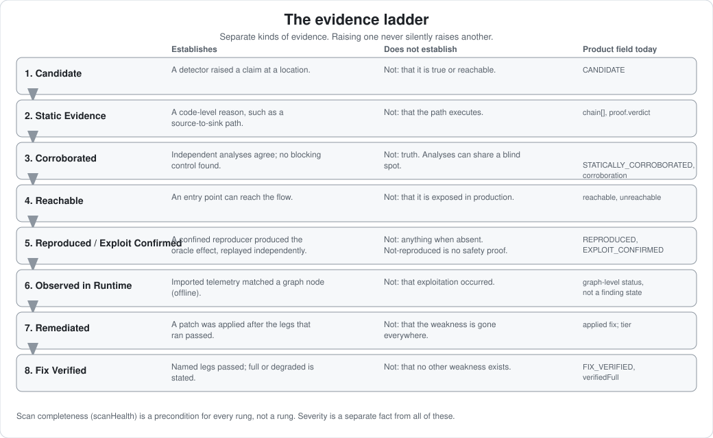

# The evidence model

<!-- seo: title="Evidence model: how Agentic Security separates severity, confidence and proof" description="A finding's severity, confidence, reachability, exploit evidence, runtime evidence and remediation completeness are different facts. Here is what each establishes and what it does not." -->



A model's opinion is not enough for a security claim. Agentic Security records **separate kinds of evidence** and never blends them into one score:

| Kind | The question it answers | Where it lives |
|---|---|---|
| **Severity** | How bad is this class of problem if it is real? | `severity` |
| **Confidence** | How strongly do independent analyses agree it is real? | `confidence`, `confidenceTier`, `corroboration` |
| **Scan completeness** | Did the analysis that produced this actually finish? | `scanHealth` on the scan |
| **Reachability** | Can an attacker's input reach this code? | `reachable`, `unreachable`, `entrypointReachable` |
| **Exploit evidence** | Has exploitation been mechanically demonstrated? | the proof record (`triage exploit --prove`) |
| **Runtime evidence** | Has this been observed in a running system? | runtime observations matched to the graph |
| **Remediation completeness** | How much of the fix landed, and which checks ran? | the fix verification record and its tier |

Raising one never silently raises another. A `critical` finding that never reproduces stays `critical`. A `high`-confidence finding from an incomplete scan is still reported alongside the incomplete scan.

## The ladder

```text
Candidate
  ↓
Static Evidence
  ↓
Corroborated
  ↓
Reachable
  ↓
Reproduced / Exploit Confirmed
  ↓
Observed in Runtime
  ↓
Remediated
  ↓
Fix Verified
```

This is a *conceptual* ladder. Not every rung is a literal product field, and a finding does not have to climb all of them. The table says, for each rung, what is a real machine state today and what is not.

| Rung | Literal product field today | Maturity |
|---|---|---|
| Candidate | `CANDIDATE` proof state; a finding with `id`, `file`, `line` | GA |
| Static Evidence | `chain[]` (when the path spans statements), `proof.verdict` | GA |
| Corroborated | `STATICALLY_CORROBORATED` proof state; `corroboration.count` and `.by` | GA |
| Reachable | `reachable` / `unreachable` (an independent dimension, not a proof state) | GA |
| Reproduced / Exploit Confirmed | `REPRODUCED`, `EXPLOIT_CONFIRMED` proof states | Preview |
| Observed in Runtime | No finding-level state. Runtime assurance is a graph-level status (`complete`, `partial`, `unavailable`) | Preview |
| Remediated | No state of its own; a fix applied and passing its legs | GA |
| Fix Verified | `FIX_VERIFIED` proof state with `--require-proof`; otherwise the verification tier | GA / Preview |

The literal proof states, in order, are `CANDIDATE → STATICALLY_CORROBORATED → REPRODUCER_GENERATED → REPRODUCED → EXPLOIT_CONFIRMED → FIX_REPLAY_BLOCKED → FIX_VERIFIED`. A state can be reached only from the one directly before it. See [Exploit proof](../guides/exploit-proof-fabric.md).

## What each rung establishes, and what it does not

### Candidate

- **Establishes:** a detector (deterministic or model-proposed) raised a specific claim at a specific location.
- **Does not establish:** that the claim is true, reachable or exploitable. Many candidates are false positives.

### Static evidence

- **Establishes:** a code-level reason for the claim, such as a taint path from a source to a sink (`chain[]`), with a static feasibility verdict (`proof.verdict: feasible` means no clean or infeasible proof could be discharged; `unproven` means no flow proof applies to that class of finding).
- **Does not establish:** that the path executes, that no control outside the analysed code blocks it, or that the input is attacker-controllable in your deployment. `feasible` is not "exploited".

### Corroborated

- **Establishes:** more than one independent analysis agrees (`corroboration.by` lists them, such as `IR-TAINT` and `STRUCTURAL`), and falsification found no context-matched control (`falsification.verdict: survived`).
- **Does not establish:** truth. Independent static analyses can share a blind spot. Corroboration raises confidence; it is not a proof.

### Reachable

- **Establishes:** the flow can be entered from an entry point such as a route handler. An unreachable finding is demoted (never dropped) and marked `unreachable: true`.
- **Does not establish:** that the entry point is exposed to an attacker in production, or that a reachable-looking path survives runtime configuration. `reachable: null` is the absence of a result, not a clean bill (a finding can be `entrypointReachable: true` while `reachable` is `null`).

### Reproduced / Exploit Confirmed

- **Establishes:** a bounded reproducer, run in a confined sandbox, produced the oracle's effect the required number of times (default three of three), and an independent replay agreed. The state, the oracle and the isolation boundary are recorded (`Completeness: DEGRADED` when the lower-assurance local sandbox was used).
- **Does not establish:** anything when it is absent. `not-reproduced` is not a safety proof; the reproducer may be wrong. It does not establish exploitability in production, and an oracle bounds only the effect it tests.

### Observed in Runtime

- **Establishes:** imported telemetry matched a node in the scanned graph, so the code path or destination was seen to be used (Preview, offline import only).
- **Does not establish:** that exploitation occurred. The adapters match destinations such as routes, services, tables and topics; they carry no function-level or identity data. Missing telemetry is reported as `partial` or `unavailable`, never as no risk.

### Remediated

- **Establishes:** a patch was applied, after passing the verification legs that ran.
- **Does not establish:** that the weakness is gone everywhere. A `MITIGATION` or `WORKAROUND` tier says the sink was reduced or bypassed, not removed.

### Fix verified

- **Establishes:** the named legs passed. The record lists every leg as pass, fail or skip, and `verifiedFull` plus `degradedLegs[]` say whether verification was full or degraded. With `--require-proof`, the original exploit reproduced beforehand and is blocked afterward.
- **Does not establish:** that no other weakness exists, or that a degraded verification was full. A bare "verified" is never printed without the legs behind it.

## Scan completeness is a precondition, not a rung

Every rung assumes the analysis ran. `scanHealth.status` is `complete` or `partial`, with the reasons in `conditions[]`. A scan with zero actionable findings and a `partial` status is reported as "scan incomplete, cannot confirm safe to deploy", never as clean. Read [Scan health](../trust/scan-health.md).

## Reading a real finding

[One finding's journey](../workflows/one-findings-journey.md) walks a real finding from the demo app through every stage with captured output, including the stages that honestly report "nothing ran". The field-by-field reference is [Reading a finding's evidence](../walkthroughs/finding-evidence.md).

## How the model protects you from itself

- A model never sets severity. Agentic discovery cannot emit `critical`.
- Falsification can only lower confidence; reachability is the single stage that may lower severity, and only on positive evidence.
- Proof is decided by a deterministic oracle, not a model.
- Fields that are not implemented are not invented. Roadmap rungs have no field.
