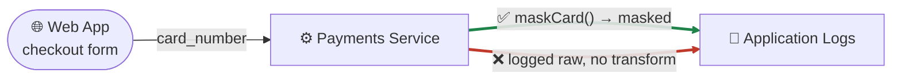

# Capability reference (moved from the README)

<!-- seo: title="Capability reference: detail moved from the README" description="The detailed capability descriptions, sample output, compliance framework table and benchmarking notes that used to open the README, preserved in full." -->

The README now opens with the assurance lifecycle and links here. Nothing below was removed; it moved. Each section keeps its original wording, with prose em-dashes replaced by commas.

For the maturity of any capability named here, the authority is [`docs/capabilities.yaml`](../capabilities.yaml), not this page.

Contents: [What it does](#what-agentic-security-does) · [Findings vs. assurance](#findings-vs-assurance) · [See it in action](#see-it-in-action) · [What makes it different](#what-makes-it-different) · [Fixes are verified, not trusted](#fixes-are-verified-not-trusted) · [Stop overpaying for tokens](#stop-overpaying-for-tokens) · [Code Boundaries](#code-boundaries) · [Local AI](#run-ai-assisted-security-analysis-locally-with-ollama) · [Vulnerability classes](#vulnerability-classes-detected) · [Security benchmarking](#security-benchmarking) · [Compliance frameworks](#compliance-frameworks)

---

## What agentic-security does

Five capabilities, each answering a question a plain vulnerability scanner doesn't:

**Find It.** A 12-pillar deterministic scan, SAST, SCA (OSV + CISA KEV + function-level reachability), secrets, IaC, prompt-injection, MCP/agent-tool audit, auth/authZ, across 9 first-class languages plus Haskell and Nix/NixOS (each measured per capability). Where a data flow is involved, the finding carries `chain[]`, a real hop-by-hop path from where tainted data entered to where it reached the sink, not just a line number.

**Prove It.** A scan reports on itself, not just on your code. The `scanHealth` object tracks whether every analyzer actually finished, files scanned, analyzers completed vs. failed vs. timed out, feed freshness (KEV/EPSS/calibration), and `toShipVerdict()` folds that into the one-screen answer everyone actually reads: `✅ Safe to deploy` only when there are zero actionable findings **and** the scan itself completed cleanly. Zero findings from an incomplete scan is `⚠️ Scan incomplete, cannot confirm safe to deploy`, never a false green light. See [Findings vs. assurance](#findings-vs-assurance) below.

**Fix It Safely.** Every patch, a rule's stored fix, a zero-LLM deterministic swap, or one an agent composed for a finding with no stored fix, goes through the same gate before it's written: rescan-clean, no new finding of medium severity or higher, lint-clean. A completeness tier (`FULL` / `MITIGATION` / `WORKAROUND`) tells you honestly how much of the fix actually landed, and a residual-risk guard rejects a hand-wavy "adequately handled" claim that the mechanical evidence contradicts.

**Govern It.** Automated technical-control evidence for 10 bundled compliance frameworks, an egress policy, configured via `mode: allow`/`deny`/`local-only`, that returns an `allow`/`deny` decision on every outbound model call *before* a prompt is even built, and state governance, TTL-bound retention, opt-in encryption, `export`, `legal-hold`, for everything the scanner writes to disk.

**Explain It.** No CVE jargon. Every finding explains the stakes, an estimated dollar cost (`riskDollars`, honestly labeled `scenario_default` until you configure your own organization's numbers), and the fix, in language a non-security teammate can act on.

| Capability | What Agentic Security Answers |
|---|---|
| **Find It** | Where is the code actually exploitable: not just where a pattern happened to match? |
| **Prove It** | Did the scan itself finish, or is "0 findings" secretly an incomplete analysis? |
| **Fix It Safely** | Did this patch actually work, or did it just make the detector stop firing? |
| **Govern It** | What evidence do I have for an auditor, a privacy reviewer, or a security lead: and what does the tool honestly admit it couldn't check? |
| **Explain It** | What's the real-world stakes of this finding, in language the whole team understands? |

---

---

## Findings vs. assurance

The quickstart run above shows why "0 findings" was never actually the same claim as "safe to deploy." A scan answers two different questions, *what did we find*, and *did the analysis that looked for it actually finish*, and `toShipVerdict()` (`scanner/src/report/index.js`) is the one place both get folded into a single, three-state answer:

```js
const scanIncomplete = scan.scanHealth?.status && scan.scanHealth.status !== 'complete';
const clean = actionable.length === 0 && !scanIncomplete;
```

- **`clean` → `✅ Safe to deploy`**, zero actionable findings, and the scan itself completed. The only state that means what "0 findings" used to be assumed to mean.
- **`scanIncomplete`, zero actionable findings → `⚠️ Scan incomplete, cannot confirm safe to deploy`**, nothing actionable turned up, but the analysis didn't finish cleanly (the same EPSS-staleness condition from the quickstart above, on a run that happened to have zero findings instead of 45). "Nothing found" can't be read as "nothing's there."
- **otherwise → `❌ Not safe to deploy`**, actionable findings exist, regardless of scan health.

A scan that finds nothing is no longer automatically "safe", it's only safe if it also finished cleanly. That's what `scanHealth` exists to make visible, and it's structurally protected: one analyzer throwing an exception is isolated (`runDetector()` in `pipeline/detector-runner.js`) so it can't silently drop every *other* analyzer's findings for that file, a real gap the project found and fixed during its own assurance-hardening work (two detectors, `scanWeb3Advanced` and `scanK8sAdmission`, were bypassing the isolating wrapper).

Full walkthrough with the real `scanHealth` JSON shape, field by field, and the fault-isolation story in detail: **[Scan health](../walkthroughs/scan-health.md)**.

---

---

## See it in action


```text
─────────────────────────────────────────────────────────────────
  ❌  Not safe to deploy  ·  api-billing
─────────────────────────────────────────────────────────────────
   3 critical · 8 high · 22 medium · 41 advisory
   🔥 2 actively exploited in the wild (CISA KEV)
   ✓  1 CONFIRMED (PoC built by /triage --validate)

   [critical] SQL Injection                api/users.ts:42
     Could leak PII for ~5,000 users.
     Estimated cost if exploited: $125k–$1.3M
     Fix:  use parameterized query — db.query('SELECT * FROM users WHERE id = ?', [id])

   [critical] Hardcoded Stripe live key    src/lib/billing.ts:7
     Could enable fraudulent charges against your account.
     Estimated cost if exploited: $50k–$500k (chargebacks + Stripe fees)
     Fix:  rotate via /agentic-security:fix --rotate-secret --auto, then move to env var

   [critical] Missing webhook signature    api/stripe-webhook.ts:12
     Anyone can POST a fake "payment.succeeded" and unlock paid features.
     Estimated cost if exploited: cost of a free subscription × every attacker
     Fix:  stripe.webhooks.constructEvent(rawBody, signature, endpointSecret)

   How many do you want to fix?
     1. Critical only           (3 fixes)
     2. Critical + High         (11 fixes)
     3. Critical + High + Medium (33 fixes)
─────────────────────────────────────────────────────────────────
```

No CVE jargon. The stakes, the cost, the fix. Every dollar estimate above is honestly scoped, see [Risk in dollars](../guides/risk-dollars.md) for the disclosure mechanism behind it, and [Reading a finding's evidence](../walkthroughs/finding-evidence.md) for what backs a real finding field by field.

---

---

## What makes it different

- **Plain-English findings with dollar-cost estimates.** Best/likely/worst-case exposure, grounded in IBM Cost of a Data Breach 2024 and 25+ public settlement records, honestly labeled `scenario_default` until you configure your own organization's inputs, see [Risk in dollars](../guides/risk-dollars.md). Not CVE numbers.
- **Intercepts insecure AI-generated code before it hits disk.** The `/setup --bodyguard` hook blocks SQLi via concat, hardcoded API keys, `eval` on user input, and more, in real time, as your AI writes.
- **12-pillar scan in one command.** SAST, SCA, secrets, IaC, LLM safety, MCP agent-tool audit, auth/authZ, pipeline integrity, container **build files**, deploy config, supply chain, and trend tracking.
  <br>_Container scope: Dockerfiles and compose files are analysed as source by `scan`. **Built images** (OCI/Docker tar archives) are scanned separately via `agentic-security image scan`, real base-image CVE correlation (reusing this engine's own SCA pipeline), layer secret extraction (including a secret added then deleted by a later layer but still recoverable), and signature/attestation verification. Images can also be read from a local Docker/Podman engine (`--engine`) or fetched from one explicitly named registry reference (`--registry`, HTTPS, digest-verified), signatures can be checked through cosign (`image verify --cosign`), and `image scan --attest` writes an Ed25519-signed evidence bundle that `verify-attestation` checks. Those paths were tested against stand-ins and a mock registry, not a real daemon or registry, see [Source-to-artifact provenance](../guides/artifact-provenance.md)._
- **Function-level reachability across every dependency.** OSV ecosystem_specific parsing, GHSA fix-commit analysis, vendored code fingerprinting, Java IR call-graph matching, and LLM-assisted function extraction, not just a hardcoded hints list.
- **SCA reachability tiers.** Every dependency classified as `function-reachable`, `import-reachable`, `build-only`, `manifest-only`, or `transitive-only`, so you fix what matters.
- **CISA KEV + EPSS prioritization.** Separates "this could theoretically be bad" from "people are running scripts that exploit this today."
- **SARIF codeFlows for taint traces.** Multi-step source-to-sink paths (the same `chain[]` evidence covered in [Reading a finding's evidence](../walkthroughs/finding-evidence.md)) rendered natively in GitHub Code Scanning, DefectDojo, and VS Code SARIF Viewer.
- **One-command fix, always verified.** Every patch is previewed, backed up, and revertible, see [Fixes are verified, not trusted](#fixes-are-verified-not-trusted) below.
- **Auto-baseline for legacy codebases.** `--set-baseline` snapshots existing findings; `--since-baseline` shows only what's new. Day-one usable on any project.
- **Refutes its own findings.** A default falsification pass (`posture/falsification.js`) takes each candidate and tries to *disprove* it, looking for the control that would actually block it (a context-matched sanitizer, a dominating guard) and demoting confidence on the ones it can. Recall-preserving: nothing is silently dropped, and `severity` is never touched by this pass. See [Concepts: evidence before severity](../concepts.md#evidence-before-severity).
- **Coverage you can audit.** Enumerates every attacker-reachable entry point, HTTP handlers, queue consumers, cron jobs, CLI args, uploads, and reports the disposition of each, so you can see it looked at your whole attack surface, not just where a finding happened to fire. A confirmed finding then triggers a repo-wide sweep for sibling instances the detectors missed, with honest "N found / M candidate / K mitigated" accounting.
- **An LLM discovery layer the deterministic engine keeps honest.** `hunt` partitions your call graph into disjoint focus areas and sends each through seven independent lenses, injection, authorization, crypto, business logic, feature abuse, chained, wildcard, to propose the flaws no rule can encode. Nothing it proposes is taken on faith: every candidate is routed back through the taint engine for corroboration, then faces a three-angle panel prompted to *refute* it, and only a majority refutation drops it. Severity comes from the evidence tier, never from the model, so this layer cannot emit `critical`. If the endpoint is missing or the panel goes silent, the report says so in plain words rather than reporting a clean run it did not earn. See [Deterministic vs. model-assisted](../concepts.md#deterministic-vs-model-assisted).
- **Hardens itself against the code it scans.** A tested threat model treats attacker-authored finding text as untrusted input everywhere it reaches an LLM prompt or a rendered PR/issue report, so the tool can't be turned against you by the repo it's auditing. See [Agent threat model](../AGENT_THREAT_MODEL.md).
- **Corroborates static findings against what actually happened.** `runtime ingest` layers real telemetry (OpenTelemetry, Envoy, Kubernetes audit logs, HTTP access logs) onto the already-scanned graph and reports an honest `complete`/`partial`/`unavailable` assurance status, never silently reads "no telemetry imported" as "no risk." See [Runtime-Corroborated Security Twin](../guides/runtime-twin.md).
- **Traces a finding to the exact artifact that ships it.** `image scan` + `provenance trace` connect Git commit → build → OCI digest → SBOM component → finding → deployment, and catch the case a CVE scanner alone can't: source is fixed, but the deployed image still isn't, `SOURCE: FIXED` / `DEPLOYED ARTIFACT: STILL VULNERABLE` / `PRODUCTION EXPOSURE: PRESENT`. See [Source-to-artifact provenance](../guides/artifact-provenance.md).

Deep engine details, [architecture](../ARCHITECTURE.md) · [finding lifecycle](../architecture/finding-lifecycle.md).

---

---

## Fixes are verified, not trusted

Every patch, whether it's a rule's stored fix, a zero-LLM deterministic swap, or one an agent composed for a finding with no stored fix, goes through the same gate before it touches disk: **rescan-clean, no new ≥medium finding, lint-clean.** If a patch doesn't pass, it isn't written. This is what makes `/find-and-fix-everything` real instead of a to-do list:

- **Deterministic zero-LLM patches** for safe, context-independent classes (weak hash → SHA-256, TLS verification re-enabled), no model call, no guessing.
- **A verified path for everything else.** A finding with only a template or a plain-English remediation note, the common case, is now fixable: the agent composes the patch, the deterministic verifier proves it safe, then it's applied.
- **Regression tests ship with the fix.** When the scan built a PoC for a finding, the generated test comes along, it fails before the patch and passes after.
- **Parallel, and it doesn't stop at the first flake.** Independent findings fix concurrently; a single failing test doesn't halt the batch, every finding gets a fixed/skipped/refused verdict, and the loop reports its own **acceptance rate**.
- **You can see your security debt aging.** Every scan stamps each finding's age and flags anything past its remediation SLA (critical: 7 days, high: 30, …).
- **Every fix carries an honest completeness tier.** `FULL` / `MITIGATION` / `WORKAROUND`, computed from mechanical signals (did the sink change? are all callers routed through the fix? does a test flip from fail to pass?), and a residual-risk guard rejects hand-wavy "adequately handled" claims, so a partial fix can never masquerade as a complete one.

Real captured verification legs, real rejection messages, and the three separate verify-loop vocabularies this project uses (never blended into one): **[Verified remediation](../walkthroughs/verified-remediation.md)**.

---

---

## Stop overpaying for tokens

Your agentic workforce runs on tokens. agentic-security watches each prompt and tells you when a cheaper model or lower reasoning depth would answer it just as well, and it's the only tool that does this **cache-aware**, accounting for the prompt cache a model switch would throw away.

```text
💡 This simple one-off sits on a deep warm cache (~250k tokens). Switching your
   main model would discard it — instead run this as a Haiku 4.5 subagent: it
   answers in its own context (~84% cheaper) and leaves your Opus 4.8 cache intact.
```

- **Per-prompt model + depth advice, cache-aware.** Suggests the cheapest model + effort that still does the job, you tap `/model` + `/effort`. Prefers a cache-preserving effort drop over a plain model switch, and shows a switch's break-even point ("worth it past ~N more turns"). Zero added tokens; the analysis is purely local.
- **Cache bodyguard.** Warns *before* an edit to `CLAUDE.md` or `.claude/settings` silently invalidates your cache and forces a costly cold re-read.
- **Measured, not guessed.** `/posture --cache` reports what prompt caching actually **saved** and **wasted** this session, in real dollars, plus a running predicted-vs-realized check on the optimizer's own advice.
- **Beyond this session, lints your own AI app's LLM calls too.** Scanning a project that calls Anthropic, OpenAI, Gemini, or xAI? It flags prompt-cache killers and over-provisioned calls, with a fix in that provider's own framework, e.g. an OpenAI app gets "gpt-5.4 at `reasoning_effort: low`."
- **Opt-in: an actual choice, not just a tip.** Set `interactive: true` and a qualifying prompt gets you a real `AskUserQuestion` menu, keep your defaults, get the `/model` command to run yourself, or have Claude apply the cheaper model to its own delegated sub-agent work for the rest of the session. Costs a little real context on the prompts where it fires, unlike everything else in this section.

On by default (advisory only, a hook can't switch your model for you); disable per-project via `/setup --model-optimizer` or the kill switch. Full detail, including the live cost HUD, session budget, and interactive mode, [cache economics](../MODEL_COST_OPTIMIZATION.md).

---

---

## Code Boundaries

A finding tells you one line is dangerous. The **Data Flow Explorer** tells
you where a piece of data, a credit card number, a patient record, a
password, comes from, everywhere it flows to, and what protects it at
every hop, across your whole architecture. Same field, same sink, two code
paths, two honestly different verdicts, never one call flagged "dangerous"
in the abstract:



```bash
AGENTIC_SECURITY_LINEAGE_DEEP=1 npx @clear-capabilities/agentic-security-scanner scan .
npx @clear-capabilities/agentic-security-scanner explore .
```

```text
agentic-security explore: serving /Users/you/your-project
  URL: http://127.0.0.1:53214/#token=3f9a1c...(64 hex chars)
  Open this URL in a browser — the page authenticates itself automatically.
```

That starts a local, **read-only, loopback-only** web server over your
already-scanned graph, nothing leaves your machine, with four linked
views: the architecture graph itself (colored by protection status),
a privacy lifecycle view (where PII/PHI/PCI/financial data goes), a
trace/evidence view (click any flow for the exact hops and evidence),
and an inventory of every source and sink, including ones nothing
currently reaches. (`explore` itself makes no model calls at all, it just
loads the already-scanned, already-signed graph and serves it locally. The
*scan* step that builds that graph is the one covered by the same egress
policy documented in [Model egress](../walkthroughs/model-egress.md).)

Everything the browser shows also exports, `png`/`svg` for a doc, a
self-contained `html` report, a DPIA or RoPA for compliance, an executive
risk briefing, or raw `json`/`csv`. Compare two scans to catch newly
introduced disclosures (`dataflow diff`), simulate a hypothetical fix
before making it (`dataflow scenario apply`, every simulated verdict is
honestly labeled `HYPOTHETICAL`, never mistaken for a real one), assess
blast radius from a compromised node, or link data flow across two
separately-scanned repositories (`federate declare`).

Full walkthrough, [Code Boundaries guide](../guides/data-flow-explorer.md). Narrative, hop-by-hop companion using this exact `card_number` example, [Watch one field's journey](../walkthroughs/privacy-data-flow.md).

---

### Run AI-assisted security analysis locally with Ollama

The deterministic scanner never needed an LLM. For the *optional* reasoning
stages, false-positive validation, patch synthesis, `hunt`, you can run a
model entirely on your own machine instead of a cloud API:

```bash
ollama pull qwen3.5:4b
export AGENTIC_SECURITY_LLM_PRESET=ollama
export AGENTIC_SECURITY_LLM_MODEL=qwen3.5:4b
agentic-security models doctor
agentic-security secure .
```

Requests are refused before they're built if the endpoint isn't literal
loopback, and a failed/unavailable Ollama call never silently falls back to a
cloud provider, the finding just stays exactly as the deterministic scanner
found it. Full guide, including the 8 GB / 16 GB RAM profiles and Gemma 4 —
[Local AI with Ollama](../guides/ollama.md).

---

---

## Run AI-assisted security analysis locally with Ollama

The deterministic scanner never needed an LLM. For the *optional* reasoning
stages, false-positive validation, patch synthesis, `hunt`, you can run a
model entirely on your own machine instead of a cloud API:

```bash
ollama pull qwen3.5:4b
export AGENTIC_SECURITY_LLM_PRESET=ollama
export AGENTIC_SECURITY_LLM_MODEL=qwen3.5:4b
agentic-security models doctor
agentic-security secure .
```

Requests are refused before they're built if the endpoint isn't literal
loopback, and a failed/unavailable Ollama call never silently falls back to a
cloud provider, the finding just stays exactly as the deterministic scanner
found it. Full guide, including the 8 GB / 16 GB RAM profiles and Gemma 4 —
[Local AI with Ollama](../guides/ollama.md).

---

---

## Vulnerability classes detected

Detected across these languages: SQL injection, command injection, path traversal, LDAP injection, XPath injection, reflected XSS, SSRF, XXE, code injection (eval / SpEL / Groovy / Roslyn / template), insecure deserialization, hardcoded secrets, weak password hashing, weak ciphers (DES/RC4/Blowfish/ECB), static/zero IV, insecure randomness, CSRF, open redirect, HTTP response splitting, unrestricted file upload, missing authentication on state-changing routes, broken object/function-level authorization (BOLA/BFLA), and ReDoS, plus the JS/Python-specific classes (prototype pollution, mass assignment) and the LLM/agent-tool surface.

---

## Security benchmarking

Agentic Security is evaluated against neutralized NIST SARD vulnerability datasets (the Juliet Test Suites for Java and C#, and the SARD PHP Vulnerability Test Suite).

Benchmark inputs are stripped of vulnerability labels, CWE-bearing filenames and package/class names, comments, and Juliet good/bad naming conventions before the scanner ever sees them, verified by a dedicated leakage audit that fails closed on any residual answer-bearing string. Scoring is vulnerability-level (per method span, not per file), reports macro-F1 as the primary metric alongside per-CWE precision/recall, a CWE confusion matrix, and localization accuracy, and splits the corpus into non-overlapping train/dev/test sets by structural template family so near-duplicate flow variants never leak across the boundary.

No benchmark scores are published in this repository, see `bench/README.md` for why. See `bench/sard/README.md` for how to run it yourself.

---

---

## Compliance frameworks

`/compliance --report <framework>` generates automated technical-control evidence, mapped against:

| Framework | `<framework>` id | Coverage map |
|---|---|---|
| NIST AI 600-1 (2024): Generative AI Profile | `nist-ai-600-1` | [coverage](../compliance/nist-ai-600-1-coverage.md) |
| NIST SP 800-171 Rev. 3: Protecting CUI¹ | `nist-800-171-r3` | [coverage](../compliance/nist-800-171-r3-coverage.md) · [demo](../brand/nist-800-171-demo.gif) |
| NIST Cybersecurity Framework 2.0 | `nist-csf-2` |: |
| NIST Privacy Framework 1.1 | `nist-privacy-1-1` | [coverage](../compliance/nist-privacy-1-1-coverage.md) |
| OWASP ASVS 5.0 | `owasp-asvs-5` | [coverage](../compliance/owasp-asvs-coverage.md) |
| OWASP Top 10 for LLM Applications 2025 | `owasp-llm-top-10` | [coverage](../compliance/owasp-llm-top10-coverage.md) |
| EU AI Act | `eu-ai-act` | [`scripts/eu-ai-act/`](../../scripts/eu-ai-act/) |
| GDPR · HIPAA Security Rule · CCPA | `gdpr` · `hipaa-security-rule` · `ccpa` |: |

¹ 800-171 is the control basis for CMMC Level 2 and DFARS 252.204-7012 contracts, but this
tool does **not** perform a CMMC assessment, compute an SPRS score, or issue a certification —
CMMC certification requires a C3PAO-conducted assessment. See [coverage: what this is
not](../compliance/nist-800-171-r3-coverage.md#what-this-is-not) before citing this report's
output in any self-attestation.

Real `compliance --list` returns all 10 of these; 5 have a dedicated per-control coverage map today, tracked as a known gap rather than papered over, see [Compliance](../guides/compliance.md).

`/compliance --walkthrough <framework>` adds step-by-step auditor narratives with per-control evidence mapping, or bring your own controls at `.agentic-security/compliance/<id>/controls.json`.

This is one of **three separate compliance-state vocabularies** this codebase uses, the framework-report flow above, the Data Flow Explorer's obligation overlay, and the custom compliance-policy gate are three distinct, differently-named systems that are never unified into one. See [Compliance](../guides/compliance.md#three-separate-compliance-state-vocabularies--not-one-unified-model) and the [glossary](../reference/glossary.md#the-three-compliance-vocabularies) for all three, named distinctly.

### NIST Privacy Framework 1.1, and what it refuses to claim

`agentic-security compliance` (also `/compliance --privacy`) assesses all 104
PF 1.1 controls and writes `.agentic-security/privacy-framework.{json,md}`. It
reads the last scan rather than re-scanning, exits **2** if there is no scan to
assess, and exits **1** only when you ask for it with `--fail-on gap`. Each gap carries an actionable
remediation and is emitted as an ordinary finding (`family: privacy-compliance`,
`CWE-359`), so `/fix` handles it like anything else. Findings are opt-in via
`AGENTIC_SECURITY_PRIVACY_FRAMEWORK=1`, a compliance opinion shouldn't silently
become your build failure.

The part worth reading: NIST rates each control for code-testability, and on
these 104 it is **23 yes, 33 partial, 48 no**. So every control lands in one of
four buckets and the bucket is always shown, **gap** (mapped signal failing),
**not assessed** (code-testable, but this engine has no signal for it),
**manual** (governance/policy, outside any scanner's reach), **satisfied**.

Controls in *not assessed* and *manual* are never counted as satisfied, and the
satisfied rate is reported over the controls actually assessed, never over all
104. A scan that examined no files reports everything as *not assessed* rather
than passing. A privacy report that quietly marks 48 governance controls "passed"
because no rule fired against them is manufacturing assurance someone will hand
to an auditor, this one tells you exactly how much of the framework it did not
check.

---
