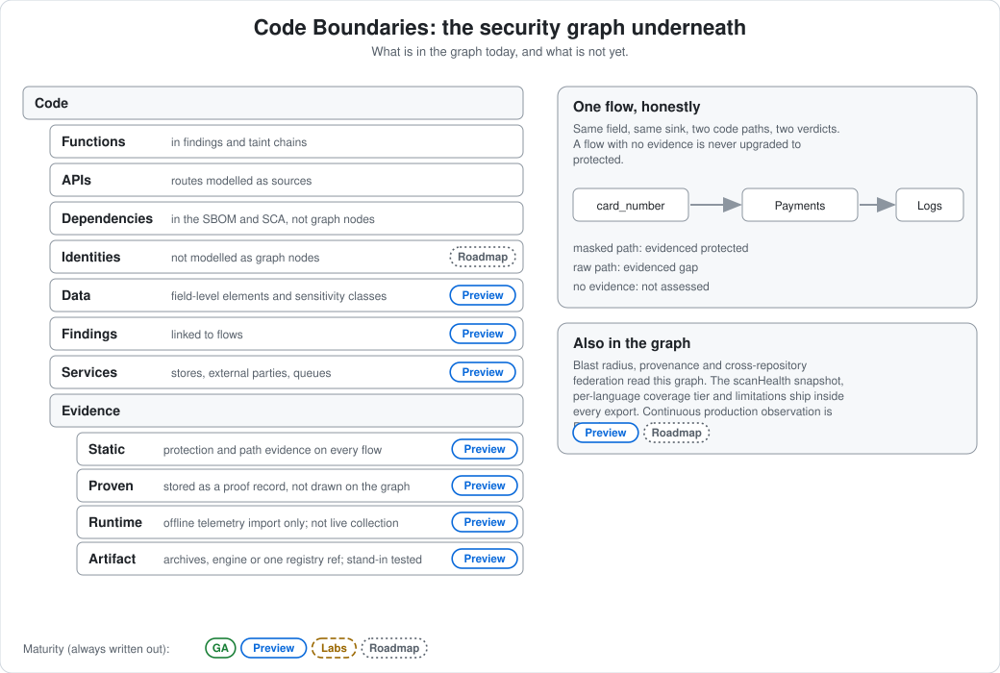

# Code Boundaries: the security graph underneath Agentic Security

<!-- seo: title="Code Boundaries: the security graph for code, data flow and evidence" description="Code Boundaries is the field-level security graph underneath Agentic Security: sources, sinks, protection state, sensitive-data classes, blast radius, provenance and federation." -->

**Maturity:** Preview



A finding says one line is dangerous. Code Boundaries is the connected model underneath the findings: it says where a piece of data comes from, everywhere it flows to, what protects it on each hop, and how every claim is evidenced. The scanner builds it from the same scan you already run. It is the substrate the [Trace](../trace/README.md) stage reads.

It is the clickable product face of the Data Flow Explorer, and the on-disk artifact is the signed `DataFlowGraph v1`.

## What the graph contains today

Documented only where it is currently supported:

| Element | What it is |
|---|---|
| Sources | Where data enters: HTTP routes and bodies, environment values, and others the source registry models |
| Sinks | Where data ends up: HTTP responses, databases, external APIs, AI model providers, logs |
| Field-level flows | Each flow carries the data elements (fields) it moves, the transformations on the way, and alternate-path counts |
| Protection state | A per-flow verdict. A flow the scanner cannot evidence is never upgraded to protected; it stays "not assessed" or unresolved |
| Findings | Flows carry `findingRefs` to the scanner findings that touch them |
| Sensitive-data classes | PII, PHI, PCI, financial and credential classes on data elements |
| Architecture nodes | Services, stores, external parties, queues and unresolved destinations |
| Blast radius | What a compromised node, edge, flow or data element can reach. See [blast radius](blast-radius.md) |
| Provenance | Which commit introduced a finding and which artifact ships it. See [provenance](provenance.md) |
| Federation | Declared links between this repository's graph and another's, each graph kept separate. See `federate declare` |

Every export carries `scanHealth`, `coverage` (per-language tier and measured recall) and `limitations`, so a graph never looks more complete than the scan that built it.

## The model, with honest status

```text
Code
├── Functions       in findings and taint chains
├── APIs            routes are modelled as sources
├── Dependencies    in SCA and the SBOM, not graph nodes
├── Identities      not modelled as graph nodes [Roadmap]
├── Data            field-level data elements and classes
├── Findings        linked to flows
├── Services        stores, external parties, queues
└── Evidence
    ├── Static      [Preview]  protection and path evidence on every flow
    ├── Proven      [Preview]  execution-backed proof exists as a separate record, not yet a graph overlay
    ├── Runtime     [Preview]  offline telemetry import marks flows runtime-observed
    └── Artifact    [Preview]  image provenance links a finding to the digest that ships it
```

The Runtime and Artifact rows are shipped in a bounded form, and the bounds matter:

- **Runtime** is offline import of exported telemetry that matches destinations, not live collection and not function- or identity-level data.
- **Artifact** reads OCI and Docker archives, a local Docker or Podman engine, or one named registry reference. The engine and registry paths were tested against stand-ins, not a real daemon or registry.
- **Proven** evidence is stored as a proof record next to the finding. It is not drawn on the graph.
- Continuous production runtime observation is **Roadmap** and is described in [observe](../observe/README.md).

## Try it

```bash
AGENTIC_SECURITY_LINEAGE_DEEP=1 npx @clear-capabilities/agentic-security-scanner scan .
npx @clear-capabilities/agentic-security-scanner explore .
```

`explore` starts a local, read-only, loopback-only server over the already-scanned graph. Nothing leaves your machine and it makes no model calls. It serves four linked views: the architecture graph colored by protection status, a privacy lifecycle view, a trace and evidence view, and an inventory of every source and sink, including ones nothing currently reaches.

Everything the browser shows also exports: `agentic-security dataflow export` writes `png`, `svg`, `pdf`, `json`, `csv`, a self-contained `html`, a DPIA or RoPA, an executive briefing, recipients and coverage reports.

## Compare, simulate, assess

- `dataflow diff` compares two scans and shows new flows, lost protections and new paths into an AI provider.
- `dataflow scenario apply` simulates a hypothetical change; every simulated verdict is labeled `HYPOTHETICAL`.
- `dataflow impact assess` reports what a compromised node can reach.
- `remediation open` tracks a blast-radius item against real rescan evidence; marking it done never closes it, only a clean rescan does.

## What it does not establish

- A graph is as complete as the scan: coverage tiers are partial per language, and the graph says so.
- It does not prove that a flow is exploitable. It records evidence and protection state.
- The browser views are a local read-only convenience; they are not a hosted dashboard.

## Go deeper

- [Code Boundaries guide](../guides/data-flow-explorer.md)
- [Watch one field's journey](../walkthroughs/privacy-data-flow.md)
- [Data Flow Explorer threat model](../DATA_FLOW_EXPLORER_THREAT_MODEL.md)
- [Data flow](data-flow.md)
