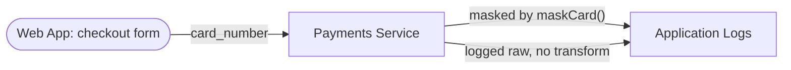

# Data flow

<!-- seo: title="Data flow in Agentic Security: field-level flows and protection verdicts" description="How the security graph models sources, sinks, field-level flows, transformations and protection verdicts, and the honest states it uses when evidence is missing." -->

**Maturity:** Preview

Data flow is the part of the [security graph](code-boundaries.md) that answers: where does a given field come from, where does it go, and what stands in its way?

## The pieces

- **Data elements** are fields classified by sensitivity (PII, PHI, PCI, financial, credentials).
- **Sources** and **sinks** are the endpoints of a flow. A source is where data enters (an HTTP body, an environment value, a route). A sink is where it lands (a database, a response, an external API, an AI model provider, a log).
- **Transformations** are what happened on the way, such as masking, hashing or encryption.
- **Flows** tie one source to one sink over edges and carry the data elements, the transformations, an evidence grade and a handling state.
- **Protection verdicts** say whether the evidence shows a flow protected, unprotected, or not assessed.

## Same field, same sink, two verdicts

A flow is judged on its own evidence:

One call is evidenced as masked. The other is evidenced as raw. They are never flattened into one "dangerous" label, and a sibling's protection never upgrades a flow the scanner cannot evidence.

## Honest states

| State | Meaning |
|---|---|
| Evidenced protected | A transformation or control is recorded on the path |
| Evidenced gap | The path is recorded and nothing protects it |
| Not assessed | The analysis did not evaluate protection for this flow |
| Unresolved destination | A dynamic destination the scanner could not resolve; kept in the inventory, never dropped |

Languages are covered at different tiers (the graph carries a per-language tier and measured recall), so a flow the scanner could not see in a partially covered language is a coverage limit, not an absence.

## Where to go

- [Watch one field's journey](../walkthroughs/privacy-data-flow.md), hop by hop
- [Code Boundaries guide](../guides/data-flow-explorer.md)
- [Privacy lane](../roles/privacy.md)
