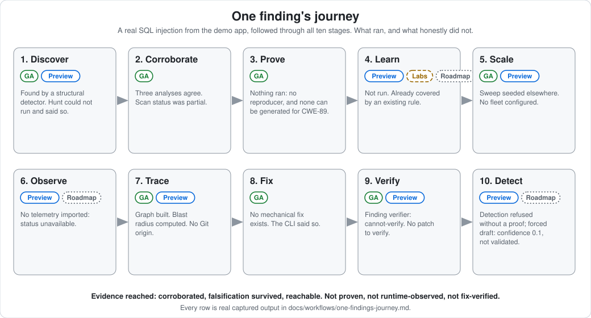

# One finding's journey

<!-- seo: title="One finding's journey: a real SQL injection through all ten assurance stages" description="A real vulnerability from the bundled demo app, followed through Discover, Corroborate, Prove, Learn, Scale, Observe, Trace, Fix, Verify and Detect, with captured output and honest stage maturity." -->



This page follows one real finding from [`examples/demo-app`](../../examples/demo-app/) through the ten stages of the [assurance lifecycle](../how-it-works/assurance-lifecycle.md).

**The finding:** `struct:server.js:11:SQL_Injection_(Template_Literal)`, a critical SQL injection (CWE-89). The order id from the URL is concatenated into a query:

```js
// server.js, lines 9-13
app.get('/orders/:id', requireAuth, (req, res) => {
  db.query(`SELECT * FROM orders WHERE id = ${req.params.id}`, (err, rows) => {
    res.json(rows);
  });
});
```

**How to read this page.** Every code block labeled *captured* is real output from running the command shown, against a scratch copy of the demo app, with the bundled scanner of this release. Output was shortened only where marked `…`. Stages that are not shipped carry a **Roadmap** badge and describe conceptual future behavior in the future tense, with no invented command. Stages that are shipped but could not run on this finding say so, with the real message.

Each stage ends with **Evidence created**, the transition into the next stage.

| # | Stage | Maturity of what ran here | What actually happened |
|---|---|---|---|
| 1 | Discover | [GA] deterministic, [Preview] agentic | Found by three deterministic analyses. `hunt` could not run (no model endpoint) and said so |
| 2 | Corroborate | [GA] | Three analyses agree; no blocking control found; scan was `partial` |
| 3 | Prove | [Preview] | Nothing ran: no reproducer exists and none can be generated for CWE-89 |
| 4 | Learn | [Labs] | Not run for this finding |
| 5 | Scale | [Preview] / [Labs] | Repo sweep seeded elsewhere; fleet not configured |
| 6 | Observe | [Preview] / [Roadmap] | No telemetry imported: status `unavailable` |
| 7 | Trace | [Preview] | Graph built; blast radius from the database computed; no Git provenance |
| 8 | Fix | [GA] | No mechanical fix exists; the CLI said so |
| 9 | Verify | [GA] | Finding verifier returned `cannot-verify`; no fix existed to verify |
| 10 | Detect | [Labs] / [Roadmap] | A static-only detection was refused without a proof, and drafted only when forced, unvalidated |

Seeing "nothing ran" in half the stages is the point. A tool that filled those rows in would be telling you something it had not established.

---

## 1. Discover

*What might be wrong?*

**Command (captured):**

```bash
agentic-security scan examples/demo-app --format json --output scan.json
```

The finding, abridged from `scan.json`:

```json
{
  "id": "struct:server.js:11:SQL_Injection_(Template_Literal)",
  "severity": "critical",
  "vuln": "SQL Injection (Template Literal)",
  "cwe": "CWE-89",
  "file": "server.js",
  "line": 11,
  "family": "sql-injection",
  "parser": "STRUCTURAL",
  "stableId": "008b65bd9c0f372d"
}
```

It was raised by a deterministic structural detector, with no model involved. The same scan also reported a hardcoded-credential finding, an `eval` on user input, a missing-CSRF finding and others; this page follows one.

**Agentic discovery** (`hunt`, Preview) is the other way a candidate could have been found. It needs a model endpoint. Captured:

```bash
agentic-security hunt --root examples/demo-app
```

```text
Discovery — 5 file(s), 3 focus area(s), 7 lens(es) each
  areas hunted: 0/3 (fully: 0)   degraded runs: 21/21
  budget: 0/200 LLM calls
…
No new candidates survived confirmation and refutation.

Coverage gaps:
  · auth.js (+2) × injection: no llmInvoke supplied and AGENTIC_SECURITY_LLM_ENDPOINT not set
```

Read it carefully: "no new candidates" here means *every one of 21 lens runs was degraded*, not that the code is clean. The command's own last lines say so: `EVERY hunter run degraded — this result says nothing about the code.` A degraded hunt is never a clean hunt.

**Evidence created:** a candidate with a location, a CWE, a family and the parser that raised it.

## 2. Corroborate

*What independent evidence supports or refutes the finding?*

Captured fields from the same finding:

```json
{
  "confidence": 0.85,
  "confidenceTier": "high",
  "corroboration": { "count": 3, "by": ["JS-FW", "REGEX", "STRUCTURAL"] },
  "proof": { "verdict": "unproven", "reasons": ["no flow-proof applicable to this finding class"] },
  "falsification": { "verdict": "survived", "reasons": ["no context-matched control found between source and sink"] },
  "reachable": true,
  "unreachable": false,
  "entrypointReachable": true,
  "exploitability": 1,
  "exploitabilityTier": "critical"
}
```

What each field says, and does not say:

- `corroboration`: three independent analyses agree. That raises confidence. It is not a proof.
- `falsification.verdict: survived`: the pass that tries to *disprove* the finding found no context-matched control between source and sink. It lowers confidence when it finds one; here it found none. It does not prove exploitability.
- `proof.verdict: unproven`: the static flow-proof does not apply to this class of finding. Read it as "no flow proof was attempted", not as "safe". (A different finding in the same scan, the taint-engine SQL injection at `db.js:11`, carries `feasible`, a static verdict that no clean or infeasible proof could be discharged. Neither is an exploit.)
- `reachable: true` and `entrypointReachable: true`: a route handler can reach it. An unreachable finding would be demoted, never dropped.
- `exploitability` and `exploitabilityTier` say how bad this would be *if real*. They are not evidence that it is.

**And the scan itself.** The scan that produced this finding reported:

```json
{ "status": "partial", "conditions": ["EPSS exploit-probability data is stale (20745 day(s) old)"] }
```

All 120 analyzers completed with none failed. The status is `partial` because one data feed was stale. Every claim in this journey carries that caveat. A gate in `strict` assurance mode would have failed on it. See [Scan health](../trust/scan-health.md).

**Evidence created:** corroboration, a falsification verdict, reachability, a confidence tier, and a scan-completeness record.

## 3. Prove

*Can exploitability be mechanically demonstrated?* [Preview]

Captured:

```bash
agentic-security triage exploit 'struct:server.js:11:SQL_Injection_(Template_Literal)' --prove
```

```text
No reproducer for struct:server.js:11:SQL_Injection_(Template_Literal), and none could be generated from the finding: no payload and oracle exist for CWE-89; supported: CWE-78, CWE-22, CWE-918 (others need a database, a deserializer or a na…
```

Exit code 4. The execution-backed proof needs a reproducer. You can supply one, and for CWE-78, CWE-22 and CWE-918 the tool can generate one (`proof generate`). For SQL injection it cannot: a real proof would need a database. So **nothing ran**. The finding stays at "corroborated". It is not "proven", and it is not downgraded.

With a reproducer, the same command runs it three times in a confined sandbox, checks a deterministic oracle, runs an independent replay, and writes a proof record whose state can reach `EXPLOIT_CONFIRMED`. `agentic-security proof doctor` shows what this host can run. See [Exploit proof](../guides/exploit-proof-fabric.md).

**Evidence created:** none. Honest "no proof attempted".

## 4. Learn

*Can a confirmed novel weakness become reusable deterministic knowledge?* [Labs]

Not run for this finding, and it should not be. SQL injection is already covered by deterministic rules; an existing detector found it, so there is no novel gap to encode. Captured:

```bash
agentic-security rules status 'struct:server.js:11:SQL_Injection_(Template_Literal)'
```

```text
No history for rule struct:server.js:11:SQL_Injection_(Template_Literal).
```

When a finding *is* a miss (no rule caught it), the Labs rule compiler (`agentic-security rules synthesize`, then `evaluate` and `promote`) can turn one proven instance into a reviewed deterministic rule with its own corpus, mutation set and shared false-positive corpus. A promotion is decided by evidence, never by a model. See [the rule compiler](../guides/rule-compiler.md).

The Security Learning Rate, which would measure how often this happens across the system, is Roadmap and does not exist yet.

**Evidence created:** none for this finding.

## 5. Scale

*Where else does this weakness exist?*

The repository sweep (Preview) counts siblings of a confirmed finding as found, candidate and mitigated. In this scan it ran from this finding and from the prompt-injection finding:

```json
{ "totals": { "found": 0, "candidates": 0, "mitigated": 0 } }
```

Zero siblings of this pattern were found by the sweep. The deterministic scan itself separately reported the Python SQL injection in `report.py:16` (CWE-89, critical) as its own finding, which is the more useful cross-reference here.

Across repositories, `fleet` (Labs) schedules leased scan jobs for a declared set of repositories and answers "which of my repositories depend on this one". It needs a `fleet.yaml` naming the repositories, which a single demo app does not have.

**Evidence created:** a sweep result; no fleet rollup.

## 6. Observe

*What has actually occurred at runtime?*

Captured:

```bash
agentic-security runtime status
```

```text
{
  "runtimeStatus": "unavailable",
  …
  "limitations": [
    "No runtime observation import exists for this scan — runtimeStatus is 'unavailable', never 'complete' or a silent absence of risk. Import telemetry with `runtime ingest` before relying on this report."
```

Offline telemetry import is Preview, and nothing was imported, so the status is `unavailable`. That is not "no exploitation occurred". Live production observation is Roadmap and does not exist.

**Evidence created:** an explicit `unavailable` status, so the absence is visible.

## 7. Trace

*How does risk connect through code, data, architecture, provenance, and artifacts?* [Preview]

Captured:

```bash
AGENTIC_SECURITY_LINEAGE_DEEP=1 agentic-security scan examples/demo-app
agentic-security dataflow export examples/demo-app --format json --output graph.json
```

The exported [security graph](../security-graph/code-boundaries.md) had 7 nodes (HTTP route and body sources, an environment source, a database store, an HTTP response sink, an external API, an unresolved AI provider), 10 flows and 10 data elements. Then, from the database store:

```bash
agentic-security dataflow impact assess examples/demo-app --target node:store:bfd50084ef5e --output impact.md --format markdown
```

```text
Target: `node:store:bfd50084ef5e` (node)
Scope: possible (traceKind: topology_reachable)

## Affected nodes (3)
- node:source:26a8476a0465
- node:source:eca115a50182
- node:store:bfd50084ef5e

## Affected data classes
- CREDENTIALS
- PII

## Coverage limitations
- js: coverage tier 'partial' (58% measured recall)
- python: coverage tier 'partial' (66% measured recall)
```

If the database behind this query were read through the injection, credentials and personal data are in its reach. `Scope: possible` is a statement about the graph's topology, not about an attack that happened, and the answer is bounded by the partial language coverage printed below it.

Git provenance did not apply: the scratch copy is not a Git repository, so the finding's `findingProvenance.status` is `not_available`. The finding says that instead of guessing a commit.

**Evidence created:** a signed graph, an impact assessment with coverage limits.

## 8. Fix

*What is the safest remediation?* [GA]

Captured:

```bash
agentic-security fix --finding 'struct:server.js:11:SQL_Injection_(Template_Literal)' --preview --root examples/demo-app
```

```text
No mechanical fix is available for this finding. Use the security-fixer subagent (default `fix` mode), or configure AGENTIC_SECURITY_LLM_PRESET=ollama for an AI-assisted proposal, then apply with `--apply`.
```

The scan's own remediation text is the parameterized-query advice. In Claude Code, the `security-fixer` agent would compose a patch through the deterministic toolchain. Without a model configured, the CLI does not invent one.

**Evidence created:** none yet. No patch exists.

## 9. Verify

*Did the fix work, and which verification legs actually ran?* [GA]

With no patch there is no fix to verify. The two verifications that do exist are different things.

**Finding verification** (is the *finding* real). Captured:

```bash
agentic-security verify --finding 'struct:server.js:11:SQL_Injection_(Template_Literal)'
```

```text
Verified 1 finding(s):
  verified-exploit: 0
  verified-by-llm: 0
  verified-sanitizer-absence: 0
  unverified-by-design: 0
  cannot-verify: 1
  server.js:11  SQL Injection (Template Literal)
    → cannot-verify (no-poc-no-sanitizer-rule)
```

`cannot-verify` is not "false". It says no proof of concept and no sanitizer rule applied.

**Fix verification** (did the *patch* work) would report re-scan, lint, tests, honesty and proof legs, each pass, fail or skip, plus a `FULL`, `MITIGATION` or `WORKAROUND` tier and the names of any skipped legs. See [Verified remediation](../trust/verified-remediation.md) for the legs with real captured output, including a rejected patch.

**Evidence created:** a verifier verdict of `cannot-verify`, with its reason.

## 10. Detect

*Was exploitation observed and can recurrence be detected?* [Labs]

The Labs `dnr` loop turns a *proven* vulnerability into a validated detection, hunts local historical logs, and scopes the exposure window. Everything is local and text-only. Captured, first the honest state of this finding:

```bash
agentic-security dnr status 'struct:server.js:11:SQL_Injection_(Template_Literal)'
```

```text
[x] FIND    Candidate finding: SQL Injection (Template Literal) (server.js:11)
[ ] PROVE   No exploit proof
[ ] HUNT    No historical hunt run
[ ] FIX     No verified remediation recorded
[ ] VERIFY  No post-fix replay recorded
[ ] DETECT  No detection generated
```

Then asking for a detection without a proof:

```text
no exploit proof for 008b65bd9c0f372d: prove it first (triage exploit 008b65bd9c0f372d --prove), or pass --allow-unproven to build a lower-confidence detection from the static finding alone
```

Forcing it with `--allow-unproven` produced a detection that says exactly how weak it is:

```text
Detection det-78cc8d803d6e for 008b65bd9c0f372d: sql-injection (static-only, confidence 0.1)
Validation: NOT_VALIDATED (0/0 synthetic cases); NOT enabled
  limitation: no endpoint is known for this finding, so no request-level rule is generated; only the payload class is described
  limitation: the exploit was not executed; this detection rests on static analysis only
```

Confidence 0.1, not validated, not enabled. That is the loop refusing to dress a guess up as a defense. With a proof (and an `attack` block naming the endpoint and parameter), the same loop generates Sigma, a generic HTTP rule, a detect-only WAF suggestion, log queries and more, validates them against synthetic exploit requests and lookalikes, and can hunt your logs.

What does **not** exist, and is Roadmap: connecting detections to a live SIEM or EDR, and observing exploitation in production telemetry. Today's hunt reads local files only. See [Detection and response](../guides/detection-and-response.md) and [the detection engineering lane](../roles/detection-engineering.md).

**Evidence created:** here, an unvalidated static-only detection record. With a proof, a validated detection and an exposure window.

---

## What this journey shows

- **Evidence is a ladder, not a score.** This finding is *corroborated*, *falsification-surviving* and *entry-point reachable*. It is not *proven*, *runtime-observed* or *fix-verified*, and the page says so at each rung. See [the evidence model](../how-it-works/evidence-model.md).
- **Honest non-results.** Hunt degraded, proof had no reproducer, runtime was unavailable, no mechanical fix existed, the detection was refused or marked unvalidated. Each said so instead of passing.
- **The scan was `partial`.** Everything above carries that caveat.
- **One finding, ten stages, four maturities.** Some stages ran for real, some correctly did not, and one half exists only as a plan.

To reproduce it yourself, start from the [5-minute demo](../quickstart/5-minute-demo.md).
